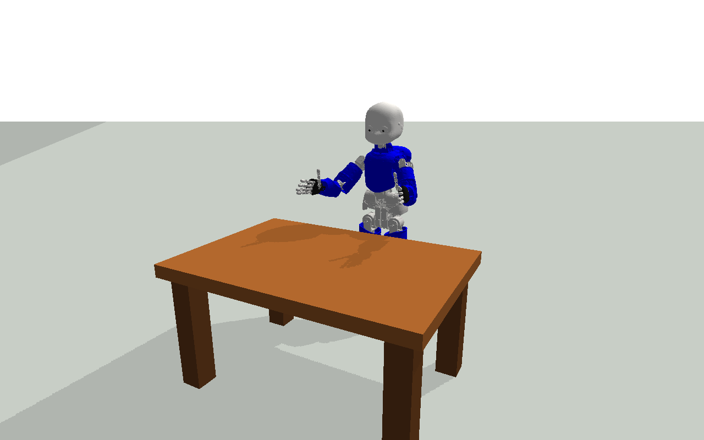
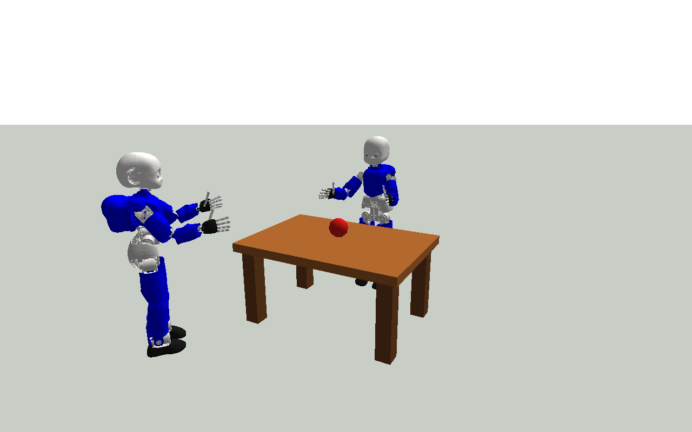
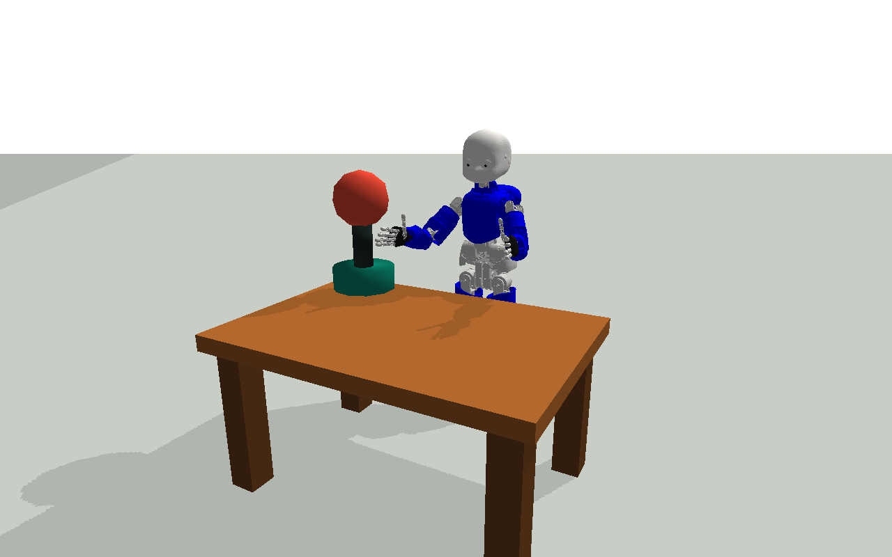

# PyCubSim2

PyCubSim2 is an extensible PyBullet simulator that starts with one PyCub and
one table. Robots, objects, sensors, behaviors, cameras, and external agents
can all be configured from one integrated GUI.

The initial iCub model and 3D assets come from
[rustlluk/pyCub](https://github.com/rustlluk/pyCub). PyCubSim2 preserves credit
to that reference project while adding a separate scene editor, multi-robot
controls, RGB-D views, webcam input, dual-view rendering, and a plugin-style
agent interface. It is not a drop-in copy of the original pyCub high-level
Python API.



## Quick Start

PyCubSim2 does not currently publish a macOS DMG. Run it from source with
Conda using the following steps.

Clone or download the complete repository first. The repository already
contains `environment.yml`; it is not downloaded separately.

```bash
git clone https://github.com/yuta4869/PyCubSim2.git
cd PyCubSim2
conda env create -f environment.yml
conda activate pycubsim2
python run_sim.py
```

`conda env create -f environment.yml` reads the YAML file in the repository and
automatically installs the declared dependencies. The current YAML also reads
`requirements.txt`, which requests NumPy, PyBullet, Pillow, and OpenCV.

#### Apple Silicon PyBullet note

On some Apple Silicon Macs, pip may download the PyBullet source archive
instead of a prebuilt wheel. Building the pinned `pybullet==3.2.5` source can
fail with a long C/C++ compiler log. This is an installation issue, not a
PyCubSim2 runtime error.

Use the following source-installation fallback when the standard environment
creation fails:

```bash
conda deactivate
conda env remove -n pycubsim2

conda create -n pycubsim2 -c conda-forge \
  python=3.10 tk numpy=1.26.4 pybullet
conda activate pycubsim2
python -m pip install Pillow==12.2.0 opencv-python-headless==4.10.0.84
python run_sim.py
```

This installs PyBullet from conda-forge instead of compiling the old PyPI
source package locally. Xcode is not required for normal use when a compatible
prebuilt package is installed.

If a local source build is intentionally required, install the Xcode Command
Line Tools and accept the Xcode license first:

```bash
xcode-select --install
sudo xcodebuild -license accept
```

### Finder and source launchers

After creating the `pycubsim2` environment, the repository's
`PyCubSim2.app` can be double-clicked in Finder. `launch.command` can also be
double-clicked or run from a terminal:

```bash
cd /path/to/PyCubSim2
./launch.command
```

These source launchers search common Miniforge, Miniconda, Anaconda,
Mambaforge, and Homebrew locations for an external Conda environment named
`pycubsim2`. Before starting, they verify that `numpy`, `pybullet`, `PIL`, and
`cv2` can be imported. They do not silently fall back to an unrelated system
Python.

If the Finder app does not start, inspect the launcher log:

```bash
cat /tmp/pycubsim2.log
```

The repository's `PyCubSim2.app` requires the external Conda environment.

When an unpinned app quits, macOS removes its icon from the Dock. To keep
PyCubSim2 there, open it once, Control-click its Dock icon, then select
`Options` > `Keep in Dock`.

## Ubuntu Packages

Ubuntu receives three native x86-64 outputs:

- `PyCubSim2-1.2-x86_64.AppImage`: portable single-file application.
- `pycubsim2_1.2_amd64.deb`: application-menu integration and
  `/usr/bin/pycubsim2`.
- `PyCubSim2-1.2-ubuntu-x86_64.tar.gz`: portable extracted directory.

The target is Ubuntu 22.04 or newer. The deb and portable directory also
include `pycubsim2-cli` for headless or automated runs. To use the AppImage:

```bash
chmod +x PyCubSim2-1.2-x86_64.AppImage
./PyCubSim2-1.2-x86_64.AppImage
```

If FUSE is unavailable, run it with
`APPIMAGE_EXTRACT_AND_RUN=1 ./PyCubSim2-1.2-x86_64.AppImage`. For native
desktop integration:

```bash
sudo apt install ./pycubsim2_1.2_amd64.deb
pycubsim2
```

The portable directory can be used without installation:

```bash
tar -xzf PyCubSim2-1.2-ubuntu-x86_64.tar.gz
./PyCubSim2-1.2-ubuntu-x86_64/PyCubSim2
```

Build all Ubuntu formats on an Ubuntu host with:

```bash
sudo apt install \
  appstream build-essential curl desktop-file-utils file \
  libfontconfig1 libgl1 libglib2.0-0 libsm6 libx11-6 libxcb1 \
  libxext6 libxfixes3 libxi6 libxrandr2 libxrender1 libxss1 \
  python3-dev python3-tk python3-venv
python3 -m venv .venv
source .venv/bin/activate
python -m pip install -r requirements.txt -r requirements-build.txt
./tools/build_ubuntu_packages.sh
```

The build performs standalone, AppImage, and extracted-deb headless smoke
tests and writes SHA-256 checksums beside the packages.

An Ubuntu 22.04 build can also be reproduced from macOS or Linux with Docker:

```bash
docker build --platform linux/amd64 \
  -f packaging/linux/Dockerfile.build \
  -t pycubsim2-ubuntu-build .
docker run --rm --platform linux/amd64 \
  -e HOME=/tmp \
  -e PYINSTALLER_CONFIG_DIR=/tmp/pyinstaller \
  -v "$PWD:/workspace" \
  -w /workspace \
  pycubsim2-ubuntu-build \
  ./tools/build_ubuntu_packages.sh
```

## Windows Packages

Windows receives two x64 outputs:

- `PyCubSim2-1.2-windows-x64-setup.exe`: per-user installer with English and
  Japanese UI, Start-menu entry, optional desktop shortcut, and uninstaller.
- `PyCubSim2-1.2-windows-x64.zip`: portable version that needs no installer.

The installer does not require administrator privileges. The target is
64-bit Windows 10 or Windows 11. Both packages include `PyCubSim2.exe` for the
high-DPI GUI and `PyCubSim2-cli.exe` for headless or automated runs.
Run the installer normally, or extract the portable ZIP and double-click
`PyCubSim2.exe`.

Build both formats on Windows with 64-bit Python 3.10 and Inno Setup 6 or 7:

```powershell
py -3.10 -m venv .venv
.\.venv\Scripts\Activate.ps1
python -m pip install -r requirements.txt -r requirements-build.txt
.\tools\build_windows.ps1
```

Pass `-TestInstaller` to install into a temporary location, launch the
installed application headlessly, and uninstall it as part of the build.
Set `SIGNTOOL_PATH` and `WINDOWS_CERT_SHA1` to Authenticode-sign the
application executable and installer.

## Native Package Builds

PyInstaller must build separately on each operating system. The
`Build platform packages` GitHub Actions workflow therefore runs on native
macOS Apple Silicon, Ubuntu 22.04 x64, and Windows x64 runners. It can be
started manually from the Actions tab and also runs for version tags. Each job
runs the tests, builds the OS-native packages, performs package smoke tests,
and uploads the results as workflow artifacts.

Local packages are unsigned except for the ad-hoc macOS signature. Production
distribution should use Apple Developer ID, Windows Authenticode, and the
appropriate release-signing process.


## Main Features

- Integrated scene editor for PyCubs, tables, primitives, and imported models
- Multiple independently controllable PyCubs
- Manual poses, keyframe actions, waving, breathing, looking, tilting, and random motion
- World-coordinate arm inverse kinematics
- World, eye, body, webcam, RGB, depth, and segmentation views
- Dual-view rendering
- Joint, IMU, contact, and range-ray sensors
- JSON scene save/load with Undo and Redo
- URDF, SDF, MJCF, OBJ, and STL import
- External agent bundles with Python controllers
- Headless rendering and automated tests

## Scene Editing

The `Scene` tab supports adding, duplicating, removing, importing, and editing
scene entities. Position and dimensions use metres (`m`), rotation uses degrees
(`deg`), and mass uses kilograms (`kg`).

`Open` and `Save` read or write the complete scene as JSON. `Reset` restores the
default one-PyCub and one-table scene. `Undo` and `Redo` cover entity addition,
removal, property edits, and placement changes.



## Cameras and Sensors

Available camera sources include the world camera, Mac webcam, each PyCub's
left eye, right eye, and body camera, cameras defined by imported agent bundles,
and a body camera for imported 3D models.

Available image modes are `Sensor RGB`, `Sensor Depth`, and `Segmentation`.
Structured sensors include joint state, IMU, contact, and 24 range rays.



## Headless Mode

```bash
python run_sim.py --headless --steps 480 \
  --output artifacts/headless_preview.png

python run_sim.py --headless --steps 480 \
  --agent examples/agents/beacon_agent/agent.json \
  --output artifacts/agent_preview.png
```

List all options:

```bash
python run_sim.py --help
```

## Tests

```bash
python -m unittest discover -s tests -v
```

The suite covers the default scene, multiple PyCubs, camera enumeration,
behaviors, IK, dynamic physics, RGB-D, metric depth, segmentation, structured
sensors, scene save/load, external controllers, placement-map editing,
Undo/Redo, dual view, and integrated GUI construction.

## Project Structure

```text
pycubsim2/
  actions.py       Built-in and JSON keyframe actions
  config.py        Scene, entity, and sensor configuration
  gui.py           Integrated GUI
  layout_editor.py Placement-map editor for arbitrary entities
  platform_ui.py   Window and macOS Dock icon integration
  plugins.py       Agent bundles and controller host
  sensors.py       RGB-D, segmentation, and webcam support
  simulation.py    PyBullet scene, physics, cameras, picking, and IK
assets/iCub/       iCub URDF, meshes, and skin data from rustlluk/pyCub
actions/           Example keyframe actions
examples/agents/   Example external agents
layouts/           Saved scenes
packaging/         PyInstaller macOS application specification
tools/             Local macOS packaging utilities
```

## Contributors and References

PyCubSim2:

- [yuta4869](https://github.com/yuta4869): project owner, integration, and
  PyCubSim2 implementation.

Reference project [rustlluk/pyCub](https://github.com/rustlluk/pyCub):

- [Lukáš Rustler](https://github.com/rustlluk): creator and primary author of pyCub
- Matěj Hoffmann: co-author of the pyCub framework publication cited by the original project
- [Ilia Zavidnyi](https://github.com/zavidnyi): contributor recorded in the original pyCub Git history

PyCubSim2 is a derivative simulator and does not claim authorship of the
original pyCub model assets or simulator work.

## Source and License

The iCub model assets are based on
[rustlluk/pyCub](https://github.com/rustlluk/pyCub) commit
`081ef65565355ca700604e40b94f8491c8e4d15a`, under CC BY 4.0.

See [THIRD_PARTY_NOTICES.md](THIRD_PARTY_NOTICES.md) and
[LICENSE](LICENSE) for attribution and license details.

The original pyCub project requests the following citation:

```bibtex
@inproceedings{rustler2026pycub,
  title={Learning with pyCub: A Simulation and Exercise Framework for Humanoid Robotics},
  author={Lukas Rustler and Matej Hoffmann},
  year={2026},
  booktitle={17th International Conference on Robotics in Education (RiE 2026)},
  organization={Springer}
}
```

---

## 日本語

PyCubSim2は、1台のPyCubと1台の机から始め、ロボット、物体、センサー、行動、
カメラ、外部エージェントを1つの統合GUIから構成できる拡張PyBullet
シミュレーターです。

初期iCubモデルと3D資産には
[rustlluk/pyCub](https://github.com/rustlluk/pyCub)を使用しています。

## 起動方法

現在、macOS用DMGは公開していません。次の手順でConda環境を作成し、
ソースから起動してください。

最初にリポジトリ全体をcloneまたはZIPでダウンロードしてください。
`environment.yml`はリポジトリに含まれており、別途ダウンロードする必要はありません。

```bash
git clone https://github.com/yuta4869/PyCubSim2.git
cd PyCubSim2
conda env create -f environment.yml
conda activate pycubsim2
python run_sim.py
```

`conda env create -f environment.yml`は、リポジトリ内のYAMLを読み込み、
宣言された依存関係を自動的に取得します。現在のYAMLは`requirements.txt`も読み込み、
NumPy、PyBullet、Pillow、OpenCVをインストールします。

### Apple SiliconでPyBulletのインストールに失敗する場合

一部のApple Silicon Macでは、pipがPyBulletのビルド済みwheelではなく、
ソースアーカイブを取得します。固定されている`pybullet==3.2.5`のローカルビルドが
長いC/C++コンパイルログを出して失敗する場合があります。これはPyCubSim2の
実行時エラーではなく、依存関係のインストールエラーです。

標準の環境作成に失敗した場合は、次の手順でPyBulletをconda-forgeから導入してください。

```bash
conda deactivate
conda env remove -n pycubsim2

conda create -n pycubsim2 -c conda-forge \
  python=3.10 tk numpy=1.26.4 pybullet
conda activate pycubsim2
python -m pip install Pillow==12.2.0 opencv-python-headless==4.10.0.84
python run_sim.py
```

この方法では、古いPyPIソースをMac上でコンパイルせず、conda-forgeのPyBulletを
使用します。互換性のあるビルド済みパッケージを使う通常利用ではXcodeは不要です。

意図的にソースビルドする場合は、Xcode Command Line Toolsを導入し、
ライセンスへ同意してください。

```bash
xcode-select --install
sudo xcodebuild -license accept
```

### Finderとソース版ランチャー

`pycubsim2`環境を作成した後は、リポジトリ内の`PyCubSim2.app`をFinderで
ダブルクリックして起動できます。`launch.command`もダブルクリックするか、
Terminalから実行できます。

```bash
cd /path/to/PyCubSim2
./launch.command
```

これらのソース版ランチャーは、Miniforge、Miniconda、Anaconda、Mambaforge、
Homebrewの一般的な配置から外部Conda環境`pycubsim2`を探します。起動前に
`numpy`、`pybullet`、`PIL`、`cv2`をimportできるか確認し、無関係な
システムPythonへ暗黙に切り替えません。

Finderから起動できない場合は、次のログを確認してください。

```bash
cat /tmp/pycubsim2.log
```

リポジトリ内の`PyCubSim2.app`には外部Conda環境が必要です。

## Ubuntuパッケージ

Ubuntu向けには、x86-64用の3形式を生成します。

- `PyCubSim2-1.2-x86_64.AppImage`: 1ファイルで持ち運べるアプリ
- `pycubsim2_1.2_amd64.deb`: アプリケーションメニューと
  `/usr/bin/pycubsim2`へ統合するパッケージ
- `PyCubSim2-1.2-ubuntu-x86_64.tar.gz`: 展開して使うportable版

対象はUbuntu 22.04以降です。debとportable directoryにはheadless実行や
自動実験用の`pycubsim2-cli`も含まれます。AppImageの起動方法:

```bash
chmod +x PyCubSim2-1.2-x86_64.AppImage
./PyCubSim2-1.2-x86_64.AppImage
```

FUSEが使えない環境では
`APPIMAGE_EXTRACT_AND_RUN=1 ./PyCubSim2-1.2-x86_64.AppImage`で起動できます。
Ubuntuへ通常のアプリとして統合する場合:

```bash
sudo apt install ./pycubsim2_1.2_amd64.deb
pycubsim2
```

portable directoryはインストールせずに起動できます。

```bash
tar -xzf PyCubSim2-1.2-ubuntu-x86_64.tar.gz
./PyCubSim2-1.2-ubuntu-x86_64/PyCubSim2
```

Ubuntu上で全形式を作成する場合:

```bash
sudo apt install \
  appstream build-essential curl desktop-file-utils file \
  libfontconfig1 libgl1 libglib2.0-0 libsm6 libx11-6 libxcb1 \
  libxext6 libxfixes3 libxi6 libxrandr2 libxrender1 libxss1 \
  python3-dev python3-tk python3-venv
python3 -m venv .venv
source .venv/bin/activate
python -m pip install -r requirements.txt -r requirements-build.txt
./tools/build_ubuntu_packages.sh
```

ビルド中にstandalone版、AppImage版、deb展開後のheadless起動を検証し、
各生成物のSHA-256 checksumも出力します。

macOSまたはLinuxからUbuntu 22.04向けビルドを再現する場合はDockerも使えます。

```bash
docker build --platform linux/amd64 \
  -f packaging/linux/Dockerfile.build \
  -t pycubsim2-ubuntu-build .
docker run --rm --platform linux/amd64 \
  -e HOME=/tmp \
  -e PYINSTALLER_CONFIG_DIR=/tmp/pyinstaller \
  -v "$PWD:/workspace" \
  -w /workspace \
  pycubsim2-ubuntu-build \
  ./tools/build_ubuntu_packages.sh
```

## Windowsパッケージ

Windows向けには、x64用の2形式を生成します。

- `PyCubSim2-1.2-windows-x64-setup.exe`: 日英表示、Startメニュー、
  任意のデスクトップショートカット、アンインストーラーを備えたユーザー単位installer
- `PyCubSim2-1.2-windows-x64.zip`: インストール不要のportable版

installerは管理者権限を必要としません。対象は64 bit版Windows 10／11です。
両形式にhigh-DPI対応GUI用`PyCubSim2.exe`とheadless／自動実験用
`PyCubSim2-cli.exe`を同梱します。
installerは通常どおり起動します。portable ZIPは展開して
`PyCubSim2.exe`をdouble-clickすると起動できます。

64 bit版Python 3.10とInno Setup 6または7を入れたWindows上で作成します。

```powershell
py -3.10 -m venv .venv
.\.venv\Scripts\Activate.ps1
python -m pip install -r requirements.txt -r requirements-build.txt
.\tools\build_windows.ps1
```

`-TestInstaller`を付けると、一時ディレクトリへのinstall、インストール済み
アプリのheadless起動、uninstallまでビルド中に検証します。
`SIGNTOOL_PATH`と`WINDOWS_CERT_SHA1`を設定すると、アプリ本体とinstallerを
Authenticode署名します。

## OS別ネイティブビルド

PyInstallerでは対象OSごとのビルドが必要です。そのため
`Build platform packages` GitHub Actions workflowは、macOS Apple Silicon、
Ubuntu 22.04 x64、Windows x64の各ネイティブrunnerを使用します。
Actionsタブから手動実行でき、version tagでも開始します。各jobはテスト、
OS向けパッケージ生成、起動検証を行い、結果をworkflow artifactとして保存します。

ローカル生成物はmacOSのad-hoc署名を除いて未署名です。正式配布時は
Apple Developer ID、Windows Authenticode、および配布先に応じた署名工程を使用します。


## 主な機能

- PyCub、机、物体、インポートモデルに対応する統合シーンエディタ
- 複数PyCubの独立制御
- 手動姿勢、キーフレーム、手振り、呼吸、見回し、傾斜、ランダム動作
- 世界座標による腕の逆運動学
- World、眼、Body、Webcam、RGB、Depth、Segmentation表示
- 独立した2画面表示
- 関節、IMU、接触、range rayセンサー
- JSONによるシーン保存・読込、Undo・Redo
- URDF、SDF、MJCF、OBJ、STLの読込
- Python Controllerを持つ外部Agent Bundle
- ヘッドレス実行と自動テスト

## テスト

```bash
python -m unittest discover -s tests -v
```

## Contributorsと参考先

PyCubSim2:

- [yuta4869](https://github.com/yuta4869): プロジェクト所有者、統合、PyCubSim2の実装

参考先 [rustlluk/pyCub](https://github.com/rustlluk/pyCub):

- [Lukáš Rustler](https://github.com/rustlluk): pyCubの作成者、主要作者
- Matěj Hoffmann: pyCubフレームワーク論文の共同著者
- [Ilia Zavidnyi](https://github.com/zavidnyi): 参考先pyCubのGit履歴に記録されたコード貢献者

## 出典とライセンス

iCubモデル資産は、CC BY 4.0で公開された
[rustlluk/pyCub](https://github.com/rustlluk/pyCub) commit
`081ef65565355ca700604e40b94f8491c8e4d15a`を基にしています。

帰属とライセンスの詳細は[THIRD_PARTY_NOTICES.md](THIRD_PARTY_NOTICES.md)と
[LICENSE](LICENSE)を参照してください。
