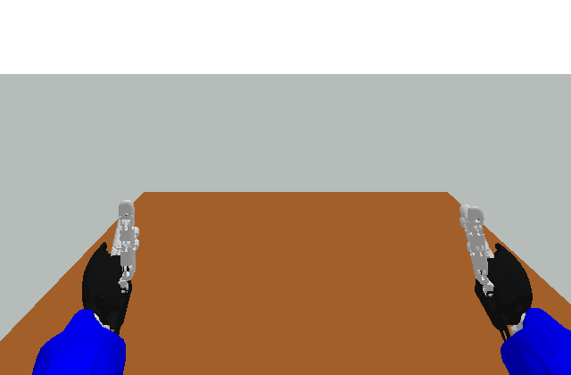
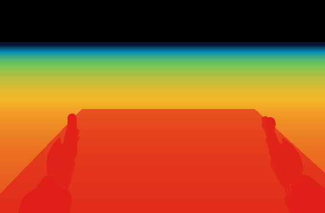
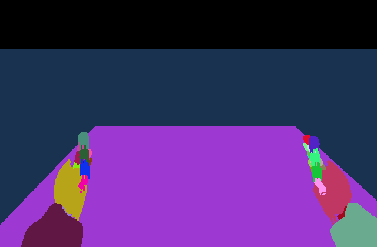

# PyCubSim2

PyCubSim2 is an extensible PyBullet simulator that starts with one PyCub and
one table. Robots, objects, sensors, behaviors, cameras, and external agents
can all be configured from one integrated GUI.

The initial iCub model and 3D assets come from
[rustlluk/pyCub](https://github.com/rustlluk/pyCub). PyCubSim2 preserves credit
to that reference project while adding a separate scene editor, multi-robot
controls, RGB-D views, webcam input, dual-view rendering, and a plugin-style
agent interface. It is not a drop-in copy of the original pyCub high-level
Python API.


## Quick Start

To run from source on macOS, Ubuntu, or Windows:

```bash
git clone https://github.com/yuta4869/PyCubSim2.git
cd PyCubSim2
conda env create -f environment.yml
conda activate pycubsim2
python run_sim.py
```

On macOS, `PyCubSim2.app` in the repository can also be double-clicked in
Finder. `launch.command` can be double-clicked or launched from a terminal:

```bash
./launch.command
```

These are source launchers. They locate an external Conda environment named
`pycubsim2` in common Miniforge, Miniconda, Anaconda, Mambaforge, and Homebrew
locations, then verify that `numpy`, `pybullet`, `PIL`, and `cv2` can be
imported before starting. They do not silently fall back to an unrelated
system Python.

If the Finder app does not start, inspect its log:

```bash
cat /tmp/pycubsim2.log
```

The repository's `PyCubSim2.app` is only a source launcher and requires the
external `pycubsim2` Conda environment. In contrast,
`dist/PyCubSim2.app`, generated by PyInstaller, includes Python and its
dependencies and normally does not require Conda on the receiving Mac.

When an unpinned app quits, macOS removes its icon from the Dock. To keep
PyCubSim2 there, open it once, Control-click its Dock icon, then select
`Options` > `Keep in Dock`.

## Standalone macOS DMG

The distribution build contains Python, Tk, PyBullet, OpenCV, Pillow, NumPy,
the PyCub model, and bundled examples. The receiving Mac does not need Conda
or a separate Python environment.

Open the DMG and drag `PyCubSim2.app` onto the included `Applications`
shortcut. The current local build targets Apple Silicon (`arm64`).

Build a local test package with:

```bash
python -m pip install -r requirements-build.txt
./tools/build_macos_dmg.zsh
```

Outputs:

```text
dist/PyCubSim2.app
dist/PyCubSim2-1.2-macos-arm64-local-adhoc.dmg
```

The local package is ad-hoc signed and is not suitable for distribution.
Gatekeeper will warn when it is downloaded and opened on another Mac.

A public package that opens normally on other Macs requires an
[Apple Developer Program](https://developer.apple.com/programs/) membership,
a `Developer ID Application` certificate with its private key in the
Keychain, and
[Apple notarization](https://developer.apple.com/documentation/security/notarizing-macos-software-before-distribution).
Check the installed signing identity:

```bash
security find-identity -v -p codesigning
```

Create a Keychain profile for `notarytool`. The password is entered at the
secure Terminal prompt and must not be written into the repository:

```bash
xcrun notarytool store-credentials "pycubsim2-notary" \
  --apple-id "developer@example.com" \
  --team-id "TEAMID"
```

Build the public distribution:

```bash
DISTRIBUTION=1 \
CODESIGN_IDENTITY="Developer ID Application: Your Name (TEAMID)" \
NOTARY_PROFILE="pycubsim2-notary" \
./tools/build_macos_dmg.zsh
```

Distribution mode stops if the Developer ID identity or notarization profile
is missing. It signs with the hardened runtime, notarizes and staples both the
app and DMG, then validates them with `codesign`, `stapler`, and Gatekeeper.
Only the resulting `PyCubSim2-1.2-macos-arm64.dmg` is a release artifact.

The GitHub Actions macOS job uses the same distribution mode. Configure these
repository secrets before running it:

- `MACOS_CERTIFICATE_P12`: Base64-encoded Developer ID `.p12`.
- `MACOS_CERTIFICATE_PASSWORD`: Password used when exporting the `.p12`.
- `MACOS_SIGNING_IDENTITY`: Full `Developer ID Application: ...` name.
- `APPLE_ID`: Apple Developer account email.
- `APPLE_TEAM_ID`: Apple Developer Team ID.
- `APPLE_APP_PASSWORD`: App-specific password used by `notarytool`.

## Ubuntu Packages

Ubuntu receives three native x86-64 outputs:

- `PyCubSim2-1.2-x86_64.AppImage`: portable single-file application.
- `pycubsim2_1.2_amd64.deb`: application-menu integration and
  `/usr/bin/pycubsim2`.
- `PyCubSim2-1.2-ubuntu-x86_64.tar.gz`: portable extracted directory.

The target is Ubuntu 22.04 or newer. The deb and portable directory also
include `pycubsim2-cli` for headless or automated runs. To use the AppImage:

```bash
chmod +x PyCubSim2-1.2-x86_64.AppImage
./PyCubSim2-1.2-x86_64.AppImage
```

If FUSE is unavailable, run it with
`APPIMAGE_EXTRACT_AND_RUN=1 ./PyCubSim2-1.2-x86_64.AppImage`. For native
desktop integration:

```bash
sudo apt install ./pycubsim2_1.2_amd64.deb
pycubsim2
```

The portable directory can be used without installation:

```bash
tar -xzf PyCubSim2-1.2-ubuntu-x86_64.tar.gz
./PyCubSim2-1.2-ubuntu-x86_64/PyCubSim2
```

Build all Ubuntu formats on an Ubuntu host with:

```bash
sudo apt install \
  appstream build-essential curl desktop-file-utils file \
  libfontconfig1 libgl1 libglib2.0-0 libsm6 libx11-6 libxcb1 \
  libxext6 libxfixes3 libxi6 libxrandr2 libxrender1 libxss1 \
  python3-dev python3-tk python3-venv
python3 -m venv .venv
source .venv/bin/activate
python -m pip install -r requirements.txt -r requirements-build.txt
./tools/build_ubuntu_packages.sh
```

The build performs standalone, AppImage, and extracted-deb headless smoke
tests and writes SHA-256 checksums beside the packages.

An Ubuntu 22.04 build can also be reproduced from macOS or Linux with Docker:

```bash
docker build --platform linux/amd64 \
  -f packaging/linux/Dockerfile.build \
  -t pycubsim2-ubuntu-build .
docker run --rm --platform linux/amd64 \
  -e HOME=/tmp \
  -e PYINSTALLER_CONFIG_DIR=/tmp/pyinstaller \
  -v "$PWD:/workspace" \
  -w /workspace \
  pycubsim2-ubuntu-build \
  ./tools/build_ubuntu_packages.sh
```

## Windows Packages

Windows receives two x64 outputs:

- `PyCubSim2-1.2-windows-x64-setup.exe`: per-user installer with English and
  Japanese UI, Start-menu entry, optional desktop shortcut, and uninstaller.
- `PyCubSim2-1.2-windows-x64.zip`: portable version that needs no installer.

The installer does not require administrator privileges. The target is
64-bit Windows 10 or Windows 11. Both packages include `PyCubSim2.exe` for the
high-DPI GUI and `PyCubSim2-cli.exe` for headless or automated runs.
Run the installer normally, or extract the portable ZIP and double-click
`PyCubSim2.exe`.

Build both formats on Windows with 64-bit Python 3.10 and Inno Setup 6 or 7:

```powershell
py -3.10 -m venv .venv
.\.venv\Scripts\Activate.ps1
python -m pip install -r requirements.txt -r requirements-build.txt
.\tools\build_windows.ps1
```

Pass `-TestInstaller` to install into a temporary location, launch the
installed application headlessly, and uninstall it as part of the build.
Set `SIGNTOOL_PATH` and `WINDOWS_CERT_SHA1` to Authenticode-sign the
application executable and installer.

## Native Package Builds

PyInstaller must build separately on each operating system. The
`Build platform packages` GitHub Actions workflow therefore runs on native
macOS Apple Silicon, Ubuntu 22.04 x64, and Windows x64 runners. It can be
started manually from the Actions tab and also runs for version tags. Each job
runs the tests, builds the OS-native packages, performs package smoke tests,
and uploads the results as workflow artifacts.

Local packages are unsigned except for the ad-hoc macOS signature. Production
distribution should use Apple Developer ID, Windows Authenticode, and the
appropriate release-signing process.

## Scene Editing

The `Scene` tab supports:

- `+ PyCub`: add another independently controllable PyCub.
- `+ Table`: add a table.
- `+ Object`: add a box, sphere, or cylinder with configurable dimensions,
  mass, color, and fixed/dynamic state.
- `Import model`: load URDF, SDF, MJCF (`.xml`), OBJ, or STL files.
- `Import agent`: load an `agent.json` bundle containing a model, cameras, and
  a Python controller.
- `Duplicate` / `Remove`: duplicate or remove the selected entity.
- `Apply`: update name, position, orientation, scale, mass, dimensions, and
  color.

Numeric labels show their units: positions and dimensions use metres (`m`),
rotations use degrees (`deg`), mass uses kilograms (`kg`), and manual joint
angles use degrees. Scale, grip, and behavior intensity are unitless.

`Open` and `Save` read or write the complete scene as JSON. `Reset` restores
the default one-PyCub and one-table scene.

`Undo` and `Redo` cover entity addition, removal, property edits, and placement
changes made from either the map or the 3D view. On macOS, use
`Command + Z` / `Command + Shift + Z`.

Properties that do not apply to the selected entity are disabled. For example,
URDF mass and materials continue to use definitions from the imported file.


## Layout Map

The `Layout` tab provides a placement map for every entity in the scene,
including PyCubs, tables, primitives, imported models, and agent bundles.

- Click an entity to select it and synchronize the Scene, Actions, and Sensors
  tabs.
- Drag an entity to move it on the X-Y plane.
- Drag the heading handle to change yaw.
- Use the mouse wheel or trackpad scroll to rotate the selected entity in
  five-degree increments.
- Enter X (`m`), Y (`m`), and Yaw (`deg`) values and press `Apply placement`
  for numeric editing.
- Press `Fit world camera` to frame the complete scene around its spatial
  center.

Placement is updated in the 3D view while dragging. One completed drag is
stored as one undoable operation.

## Actions

Each PyCub can independently use:

- Manual pose
- Idle breathing
- Look around
- Right arm wave
- Left arm wave
- Both arms wave
- Whole-body tilt
- Random motion
- Keyframe action

`Start` and `Stop` affect only the selected PyCub. Manual joint sliders, left
and right grips, and world-coordinate arm IK (`Reach`) are also per robot.
Manual or IK commands apply immediately; only time-varying behaviors require
continuous updates.

`Load action JSON` loads keyframe actions from `actions/`. Joint values are in
degrees, and grip values range from `0.0` open to `1.0` closed.

## Cameras and Sensors

Available camera sources include:

- World camera
- Webcam 0
- Left eye, right eye, and body camera for every PyCub
- Cameras defined by imported agent bundles
- A body camera for general imported 3D models

Adding a PyCub immediately adds all three of its simulated cameras to the
camera selectors. Sources are not limited to the first robot. Select the
primary source from the control above the 3D view or from the `Sensors` tab.
Select the secondary source from the `Second view` row when dual view is
enabled.

Available image modes are `Sensor RGB`, `Sensor Depth`, and `Segmentation`.
Structured sensors include joint state, IMU, contact, and 24 range rays. Each
feature can be enabled or disabled for the relevant entity.

`Export sensor snapshot` saves the displayed image and a JSON snapshot.

The first webcam use may trigger an operating-system camera permission
prompt. On Linux, the user also needs access to `/dev/video*`. A physical
webcam supplies RGB only. Depth and segmentation are generated by simulated
cameras.

The internal `depth_m` array is the metric camera-axis Z distance obtained by
unprojecting PyBullet's OpenGL depth buffer with the configured near and far
planes. The depth display uses a stable logarithmic color scale from 0.05 m to
5 m. The center-pixel distance appears in the image overlay, and missing
returns are black.

| Left eye RGB | Left eye depth | Left eye segmentation |
| --- | --- | --- |
|  |  |  |

## Camera Controls and Dual View

- `Camera` cursor + left drag: orbit.
- `Camera` cursor + Shift-left drag: pan.
- Middle drag or right drag: pan in any cursor mode.
- Mouse wheel or trackpad scroll: zoom.
- Double-click: focus the selected entity.
- `Select` cursor + click: select a PyCub, table, object, model, or agent in the
  3D scene.
- `Move` cursor + drag: move the selected entity on the X-Y plane in World or
  Top view.
- Camera tab: yaw, pitch, distance, shadows, and render quality.
- `Control + Tab` / `Shift + Control + Tab`: cycle sidebar tabs.

The selected entity is outlined in yellow. `Info`, `Actions`, and `Sensors`
open the corresponding controls for that entity.

World camera reset and `Fit whole scene` use the complete scene bounds, not
the first PyCub. Top and Side views also use the scene center.

`Dual view` splits the viewer into two independent panes. For example, the
left pane can show World while the right pane shows another PyCub's right eye,
Depth, Segmentation, or a webcam. Toggle it with the GUI or
`Command + D` on macOS and `Control + D` on Windows/Linux.

Performance mode renders at up to 1.25 times the display resolution, Balanced
at 1.65 times, and Quality at 2 times before downsampling. This avoids the old
640-pixel upscale while retaining explicit performance choices.

## External 3D Agents

Use `Import model` for a model without behavior. Use `Import agent` when a
model, cameras, and behavior should be added together.

Example:

```text
examples/agents/beacon_agent/
  agent.json
  beacon.urdf
  controller.py
```

After importing the sample, select the agent and press `Start` in the Actions
tab. Its controller performs vertical movement, turning, and neck motion.

See [docs/AGENT_BUNDLES.md](docs/AGENT_BUNDLES.md) for the manifest format and
controller API. Local controllers execute as normal Python code, so only load
trusted bundles.


## Performance

The default is `Performance` quality with shadows disabled.

- Static scenes are rendered only when the view changes.
- Fixed PyCubs and tables update only changed joints.
- Adding a dynamic object or model automatically enables 240 Hz PyBullet
  physics.
- Active behaviors advance using wall-clock-aware stepping.
- Balanced, Quality, and shadows trade additional CPU time for image quality.

For contact experiments, disable `Fixed base` on an object and use a mass
greater than zero.

## Headless Mode

```bash
python run_sim.py --headless --steps 480 \
  --output artifacts/headless_preview.png

python run_sim.py --headless --steps 480 \
  --agent examples/agents/beacon_agent/agent.json \
  --output artifacts/agent_preview.png
```

List all options:

```bash
python run_sim.py --help
```

## Tests

```bash
python -m unittest discover -s tests -v
```

The suite covers the default scene, multiple PyCubs, camera enumeration,
behaviors, IK, dynamic physics, RGB-D, metric depth, segmentation, structured
sensors, scene save/load, external controllers, placement-map editing,
Undo/Redo, dual view, and integrated GUI construction.

## Project Structure

```text
pycubsim2/
  actions.py       Built-in and JSON keyframe actions
  config.py        Scene, entity, and sensor configuration
  gui.py           Integrated GUI
  layout_editor.py Placement-map editor for arbitrary entities
  platform_ui.py  Window and macOS Dock icon integration
  plugins.py       Agent bundles and controller host
  sensors.py       RGB-D, segmentation, and webcam support
  simulation.py    PyBullet scene, physics, cameras, picking, and IK
assets/iCub/       iCub URDF, meshes, and skin data from rustlluk/pyCub
actions/           Example keyframe actions
examples/agents/   Example external agents
layouts/           Saved scenes
packaging/         PyInstaller, AppImage, deb, and Windows installer specs
tools/             Reproducible macOS, Ubuntu, and Windows build scripts
```

## Contributors and References

PyCubSim2:

- [yuta4869](https://github.com/yuta4869): project owner, integration, and
  PyCubSim2 implementation.

Reference project [rustlluk/pyCub](https://github.com/rustlluk/pyCub):

- [Lukáš Rustler](https://github.com/rustlluk): creator and primary author of
  pyCub.
- Matěj Hoffmann: co-author of the pyCub framework publication cited by the
  original project.
- [Ilia Zavidnyi](https://github.com/zavidnyi): contributor recorded in the
  original pyCub Git history.

PyCubSim2 is a derivative simulator and does not claim authorship of the
original pyCub model assets or simulator work.

## Source and License

The iCub model assets are based on
[rustlluk/pyCub](https://github.com/rustlluk/pyCub) commit
`081ef65565355ca700604e40b94f8491c8e4d15a`, under CC BY 4.0.

See [THIRD_PARTY_NOTICES.md](THIRD_PARTY_NOTICES.md) and
[LICENSE](LICENSE) for attribution and license details.

The original pyCub project requests the following citation:

```bibtex
@inproceedings{rustler2026pycub,
  title={Learning with pyCub: A Simulation and Exercise Framework for Humanoid Robotics},
  author={Lukas Rustler and Matej Hoffmann},
  year={2026},
  booktitle={17th International Conference on Robotics in Education (RiE 2026)},
  organization={Springer}
}
```

---

PyCubSim2は、1台のPyCubと1台の机から始め、ロボット、物体、センサー、
行動、カメラ、外部エージェントを1つの統合GUIから構成できる拡張PyBullet
シミュレーターです。

初期iCubモデルと3D資産には
[rustlluk/pyCub](https://github.com/rustlluk/pyCub)を使用しています。
PyCubSim2は参考元へのクレジットを明記しつつ、独立したシーン編集、複数ロボット制御、
RGB-D表示、Webcam入力、2画面表示、外部エージェント機構を追加しています。
元のpyCubの高水準Python APIをそのまま複製したものではありません。


## 起動

macOS、Ubuntu、Windowsでソースから起動する場合:

```bash
git clone https://github.com/yuta4869/PyCubSim2.git
cd PyCubSim2
conda env create -f environment.yml
conda activate pycubsim2
python run_sim.py
```

macOSでは、リポジトリ内の`PyCubSim2.app`をFinderでダブルクリックして起動できます。
`launch.command`もダブルクリックするか、Terminalから実行できます。

```bash
./launch.command
```

これらはソース版ランチャーです。Miniforge、Miniconda、Anaconda、
Mambaforge、Homebrewの一般的な配置から、外部Conda環境`pycubsim2`を探します。
起動前に`numpy`、`pybullet`、`PIL`、`cv2`をimportできるか確認し、
無関係なシステムPythonへ暗黙に切り替えることはありません。

Finderから起動できない場合は、次のログを確認してください。

```bash
cat /tmp/pycubsim2.log
```

リポジトリ内の`PyCubSim2.app`はソース版ランチャーなので、外部の
`pycubsim2` Conda環境が必要です。一方、PyInstallerで生成する
`dist/PyCubSim2.app`にはPythonと依存関係が含まれ、受け取るMacでは原則として
Condaを必要としません。

Dockへ固定していないアプリは、終了するとmacOSの通常動作によってDockから消えます。
残す場合は、起動中のDockアイコンをControl-clickし、
`オプション` > `Dockに追加`を選択してください。

## 自己完結macOS DMG

配布版にはPython、Tk、PyBullet、OpenCV、Pillow、NumPy、PyCubモデル、
サンプルを同梱します。受け取るMac側にCondaや別のPython環境は必要ありません。

DMGを開き、`PyCubSim2.app`を同梱の`Applications`ショートカットへドラッグします。
現在のローカルビルドはApple Silicon（`arm64`）用です。

ローカル検証用パッケージを作成する場合:

```bash
python -m pip install -r requirements-build.txt
./tools/build_macos_dmg.zsh
```

生成物:

```text
dist/PyCubSim2.app
dist/PyCubSim2-1.2-macos-arm64-local-adhoc.dmg
```

ローカル版はad-hoc署名で、公証されていないため配布用には使えません。
他のMacへダウンロードして開くとGatekeeperの警告が表示されます。

他のMacで通常どおり開ける公開版には、
[Apple Developer Program](https://developer.apple.com/programs/)への加入、
秘密鍵を含む`Developer ID Application`証明書のKeychainへの登録、および
[Appleの公証](https://developer.apple.com/documentation/security/notarizing-macos-software-before-distribution)
が必要です。登録済みの署名IDは次のコマンドで確認できます。

```bash
security find-identity -v -p codesigning
```

`notarytool`用のKeychain profileを作成します。パスワードはTerminalの安全な
プロンプトで入力し、リポジトリには記録しません。

```bash
xcrun notarytool store-credentials "pycubsim2-notary" \
  --apple-id "developer@example.com" \
  --team-id "TEAMID"
```

公開用パッケージを作成する場合:

```bash
DISTRIBUTION=1 \
CODESIGN_IDENTITY="Developer ID Application: Your Name (TEAMID)" \
NOTARY_PROFILE="pycubsim2-notary" \
./tools/build_macos_dmg.zsh
```

公開モードではDeveloper IDまたは公証profileがなければ処理を停止します。
Hardened Runtimeで署名し、アプリとDMGの両方を公証・stapleした後、
`codesign`、`stapler`、Gatekeeperで検証します。公開してよい生成物は
`PyCubSim2-1.2-macos-arm64.dmg`だけです。

GitHub ActionsのmacOS jobも同じ公開モードを使用します。実行前にリポジトリへ
次のSecretsを登録してください。

- `MACOS_CERTIFICATE_P12`: Developer IDの`.p12`をBase64化した内容
- `MACOS_CERTIFICATE_PASSWORD`: `.p12`書き出し時のパスワード
- `MACOS_SIGNING_IDENTITY`: `Developer ID Application: ...`の完全な名前
- `APPLE_ID`: Apple Developerアカウントのメールアドレス
- `APPLE_TEAM_ID`: Apple Developer Team ID
- `APPLE_APP_PASSWORD`: `notarytool`で使うアプリ用パスワード

## Ubuntuパッケージ

Ubuntu向けには、x86-64用の3形式を生成します。

- `PyCubSim2-1.2-x86_64.AppImage`: 1ファイルで持ち運べるアプリ
- `pycubsim2_1.2_amd64.deb`: アプリケーションメニューと
  `/usr/bin/pycubsim2`へ統合するパッケージ
- `PyCubSim2-1.2-ubuntu-x86_64.tar.gz`: 展開して使うportable版

対象はUbuntu 22.04以降です。debとportable directoryにはheadless実行や
自動実験用の`pycubsim2-cli`も含まれます。AppImageの起動方法:

```bash
chmod +x PyCubSim2-1.2-x86_64.AppImage
./PyCubSim2-1.2-x86_64.AppImage
```

FUSEが使えない環境では
`APPIMAGE_EXTRACT_AND_RUN=1 ./PyCubSim2-1.2-x86_64.AppImage`で起動できます。
Ubuntuへ通常のアプリとして統合する場合:

```bash
sudo apt install ./pycubsim2_1.2_amd64.deb
pycubsim2
```

portable directoryはインストールせずに起動できます。

```bash
tar -xzf PyCubSim2-1.2-ubuntu-x86_64.tar.gz
./PyCubSim2-1.2-ubuntu-x86_64/PyCubSim2
```

Ubuntu上で全形式を作成する場合:

```bash
sudo apt install \
  appstream build-essential curl desktop-file-utils file \
  libfontconfig1 libgl1 libglib2.0-0 libsm6 libx11-6 libxcb1 \
  libxext6 libxfixes3 libxi6 libxrandr2 libxrender1 libxss1 \
  python3-dev python3-tk python3-venv
python3 -m venv .venv
source .venv/bin/activate
python -m pip install -r requirements.txt -r requirements-build.txt
./tools/build_ubuntu_packages.sh
```

ビルド中にstandalone版、AppImage版、deb展開後のheadless起動を検証し、
各生成物のSHA-256 checksumも出力します。

macOSまたはLinuxからUbuntu 22.04向けビルドを再現する場合はDockerも使えます。

```bash
docker build --platform linux/amd64 \
  -f packaging/linux/Dockerfile.build \
  -t pycubsim2-ubuntu-build .
docker run --rm --platform linux/amd64 \
  -e HOME=/tmp \
  -e PYINSTALLER_CONFIG_DIR=/tmp/pyinstaller \
  -v "$PWD:/workspace" \
  -w /workspace \
  pycubsim2-ubuntu-build \
  ./tools/build_ubuntu_packages.sh
```

## Windowsパッケージ

Windows向けには、x64用の2形式を生成します。

- `PyCubSim2-1.2-windows-x64-setup.exe`: 日英表示、Startメニュー、
  任意のデスクトップショートカット、アンインストーラーを備えたユーザー単位installer
- `PyCubSim2-1.2-windows-x64.zip`: インストール不要のportable版

installerは管理者権限を必要としません。対象は64 bit版Windows 10／11です。
両形式にhigh-DPI対応GUI用`PyCubSim2.exe`とheadless／自動実験用
`PyCubSim2-cli.exe`を同梱します。
installerは通常どおり起動します。portable ZIPは展開して
`PyCubSim2.exe`をdouble-clickすると起動できます。

64 bit版Python 3.10とInno Setup 6または7を入れたWindows上で作成します。

```powershell
py -3.10 -m venv .venv
.\.venv\Scripts\Activate.ps1
python -m pip install -r requirements.txt -r requirements-build.txt
.\tools\build_windows.ps1
```

`-TestInstaller`を付けると、一時ディレクトリへのinstall、インストール済み
アプリのheadless起動、uninstallまでビルド中に検証します。
`SIGNTOOL_PATH`と`WINDOWS_CERT_SHA1`を設定すると、アプリ本体とinstallerを
Authenticode署名します。

## OS別ネイティブビルド

PyInstallerでは対象OSごとのビルドが必要です。そのため
`Build platform packages` GitHub Actions workflowは、macOS Apple Silicon、
Ubuntu 22.04 x64、Windows x64の各ネイティブrunnerを使用します。
Actionsタブから手動実行でき、version tagでも開始します。各jobはテスト、
OS向けパッケージ生成、起動検証を行い、結果をworkflow artifactとして保存します。

ローカル生成物はmacOSのad-hoc署名を除いて未署名です。正式配布時は
Apple Developer ID、Windows Authenticode、および配布先に応じた署名工程を使用します。

## シーン編集

`Scene`タブでは次の操作ができます。

- `+ PyCub`: 独立して制御できるPyCubを追加
- `+ Table`: 机を追加
- `+ Object`: box、sphere、cylinderを寸法、質量、色、固定／動的の設定付きで追加
- `Import model`: URDF、SDF、MJCF（`.xml`）、OBJ、STLを読込
- `Import agent`: モデル、カメラ、Python Controllerを含む`agent.json`を読込
- `Duplicate` / `Remove`: 選択した要素を複製／削除
- `Apply`: 名前、位置、姿勢、スケール、質量、寸法、色を反映

数値ラベルには単位を表示します。位置と寸法はメートル（`m`）、回転は度（`deg`）、
質量はキログラム（`kg`）、手動関節角は度です。Scale、grip、行動強度は無次元です。

`Open`と`Save`はシーン全体をJSONとして読み書きします。`Reset`はPyCub 1台と
机1台の初期状態へ戻します。

`Undo`と`Redo`は、要素の追加、削除、プロパティ変更、マップまたは3D画面からの
配置変更に対応します。macOSでは`Command + Z` / `Command + Shift + Z`も使えます。

選択要素に適用できないプロパティは自動的に無効になります。たとえばURDFの
質量と材質はインポート元ファイルの定義を使用します。


## 配置マップ

`Layout`タブは、PyCub、机、プリミティブ、インポートしたモデル、Agent Bundleを
含む全要素の配置マップです。

- 要素をクリック: 対象を選択し、Scene、Actions、Sensorsタブと同期
- 要素をドラッグ: X-Y平面上で移動
- 向きを示すハンドルをドラッグ: yawを変更
- マウスホイール／トラックパッドスクロール: 選択要素を5度ずつ回転
- X（`m`）、Y（`m`）、Yaw（`deg`）を入力して`Apply placement`: 数値で配置
- `Fit world camera`: 空間全体の中心を基準に全要素を画面へ収める

ドラッグ中も3D画面へ反映され、確定した1回のドラッグは1回のUndoで戻せます。

## 行動

各PyCubは次の行動を個別に利用できます。

- Manual pose
- Idle breathing
- Look around
- Right arm wave
- Left arm wave
- Both arms wave
- Whole-body tilt
- Random motion
- Keyframe action

`Start`と`Stop`は選択中のPyCubだけに作用します。手動関節スライダー、左右のgrip、
世界座標を使う腕のIK（`Reach`）も個体ごとに独立しています。手動またはIK指令は
即時反映され、時間変化する行動だけが継続更新されます。

`Load action JSON`では`actions/`のキーフレーム行動を読み込めます。関節値は度、
gripは`0.0`（開）から`1.0`（閉）です。

## カメラとセンサー

次のカメラ源を選択できます。

- World camera
- Webcam 0
- 全PyCubのLeft eye / Right eye / Body camera
- Agent Bundleが定義したカメラ
- 一般のインポート3Dモデルに付くBody camera

PyCubを追加すると、その個体の3種類のシミュレーションカメラが選択候補へ
即時追加されます。最初のPyCubだけに固定されていません。主画面のカメラは
3D画面上部または`Sensors`タブ、副画面は2画面表示中の`Second view`行から
切り替えます。

表示形式は`Sensor RGB`、`Sensor Depth`、`Segmentation`です。構造化センサーには
joint state、IMU、contact、24本のrange rayがあり、関連する要素ごとに各機能を
有効または無効にできます。

`Export sensor snapshot`は表示画像とJSONスナップショットを保存します。

Webcamを初めて使うと、OSのカメラ許可が表示される場合があります。Linuxでは
`/dev/video*`へのアクセス権も必要です。物理WebcamはRGBのみで、Depthと
Segmentationはシミュレーションカメラから生成されます。

内部配列`depth_m`は、PyBulletのOpenGL depth bufferをnear/far平面から逆射影した、
カメラ光軸方向のメートル単位Z距離です。Depth表示は0.05 mから5 mまでの固定対数色尺度を
使用します。中央画素の距離は画像上に表示され、レイが届かない場所は黒になります。

| Left eye RGB | Left eye depth | Left eye segmentation |
| --- | --- | --- |
|  |  |  |

## カメラ操作と2画面表示

- `Camera`カーソル + 左ドラッグ: orbit
- `Camera`カーソル + Shift + 左ドラッグ: pan
- 中央ドラッグ／右ドラッグ: カーソルモードに関係なくpan
- マウスホイール／トラックパッドスクロール: zoom
- ダブルクリック: 選択要素へfocus
- `Select`カーソル + クリック: 3Dシーン内のPyCub、机、物体、モデル、Agentを選択
- `Move`カーソル + ドラッグ: WorldまたはTop画面で選択要素をX-Y移動
- Cameraタブ: yaw、pitch、distance、shadow、画質
- `Control + Tab` / `Shift + Control + Tab`: サイドバータブを切替

選択要素は黄色い枠で表示されます。`Info`、`Actions`、`Sensors`から、その要素の
情報、可能な行動、機能設定を開けます。

Worldカメラのリセットと`Fit whole scene`は、最初のPyCubではなく全要素の
空間境界を基準にします。TopとSideもシーン全体の中心を使用します。

`Dual view`は表示を独立した2画面に分割します。たとえば左をWorld、右を別の
PyCubの右眼、Depth、Segmentation、Webcamにできます。GUIまたはmacOSの
`Command + D`、Windows/Linuxの`Control + D`で切り替えられます。

Performanceは表示解像度の最大1.25倍、Balancedは1.65倍、Qualityは2倍で描画して
縮小表示します。旧版の640 px引き伸ばしを避けつつ、負荷を明示的に選択できます。

## 外部3Dエージェント

行動を持たないモデルは`Import model`、モデル、カメラ、行動をまとめて追加する場合は
`Import agent`を使います。

サンプル:

```text
examples/agents/beacon_agent/
  agent.json
  beacon.urdf
  controller.py
```

サンプルを読み込み、Agentを選択してActionsタブの`Start`を押すと、上下動、旋回、
首関節の行動が始まります。

Manifest形式とController APIは
[docs/AGENT_BUNDLES.md](docs/AGENT_BUNDLES.md)を参照してください。ローカルControllerは
通常のPythonコードとして実行されるため、信頼できるBundleだけを読み込んでください。


## 性能

標準設定は`Performance`、shadow無効です。

- 静止シーンは表示変更時だけ再描画
- 固定されたPyCubと机では変更関節だけを更新
- 動的物体やモデルを追加すると240 HzのPyBullet物理へ自動切替
- 行動中は壁時計に追従して更新
- Balanced、Quality、shadowはCPU負荷と引き換えに画質を向上

接触実験では物体の`Fixed base`を無効にし、質量を0より大きくしてください。

## ヘッドレス実行

```bash
python run_sim.py --headless --steps 480 \
  --output artifacts/headless_preview.png

python run_sim.py --headless --steps 480 \
  --agent examples/agents/beacon_agent/agent.json \
  --output artifacts/agent_preview.png
```

オプション一覧:

```bash
python run_sim.py --help
```

## テスト

```bash
python -m unittest discover -s tests -v
```

初期シーン、複数PyCub、カメラ列挙、行動、IK、動的物理、RGB-D、メートル単位Depth、
Segmentation、構造化センサー、シーン保存／読込、外部Controller、配置マップ、
Undo/Redo、2画面、統合GUIを検証します。

## 構成

```text
pycubsim2/
  actions.py       内蔵行動とJSONキーフレーム
  config.py        シーン／要素／センサー設定
  gui.py           統合GUI
  layout_editor.py 任意要素対応の配置マップ
  platform_ui.py  ウインドウ／macOS Dockアイコン連携
  plugins.py       Agent BundleとControllerホスト
  sensors.py       RGB-D、Segmentation、Webcam
  simulation.py    PyBulletシーン、物理、カメラ、選択、IK
assets/iCub/       参考元pyCub由来のiCub URDF／mesh／skin
actions/           サンプルキーフレーム行動
examples/agents/   外部3Dエージェントのサンプル
layouts/           保存シーン
packaging/         PyInstaller、AppImage、deb、Windows installer仕様
tools/             macOS、Ubuntu、Windows用の再現可能なビルドスクリプト
```

## Contributorsと参考先

PyCubSim2:

- [yuta4869](https://github.com/yuta4869): プロジェクト所有者、統合、
  PyCubSim2の実装

参考先 [rustlluk/pyCub](https://github.com/rustlluk/pyCub):

- [Lukáš Rustler](https://github.com/rustlluk): pyCubの作成者、主要作者
- Matěj Hoffmann: 参考先プロジェクトが示すpyCubフレームワーク論文の共同著者
- [Ilia Zavidnyi](https://github.com/zavidnyi): 参考先pyCubのGit履歴に記録された
  コード貢献者

PyCubSim2は派生シミュレーターであり、参考元pyCubのモデル資産や元のシミュレーターに
対する作者性を主張するものではありません。

## 出典とライセンス

iCubモデル資産は、CC BY 4.0で公開された
[rustlluk/pyCub](https://github.com/rustlluk/pyCub) commit
`081ef65565355ca700604e40b94f8491c8e4d15a`を基にしています。

帰属とライセンスの詳細は[THIRD_PARTY_NOTICES.md](THIRD_PARTY_NOTICES.md)と
[LICENSE](LICENSE)を参照してください。

参考先プロジェクトが示す引用形式:

```bibtex
@inproceedings{rustler2026pycub,
  title={Learning with pyCub: A Simulation and Exercise Framework for Humanoid Robotics},
  author={Lukas Rustler and Matej Hoffmann},
  year={2026},
  booktitle={17th International Conference on Robotics in Education (RiE 2026)},
  organization={Springer}
}
```
