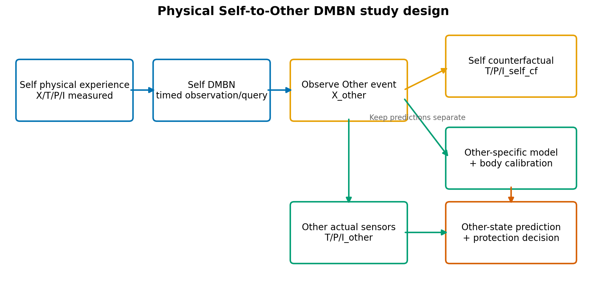
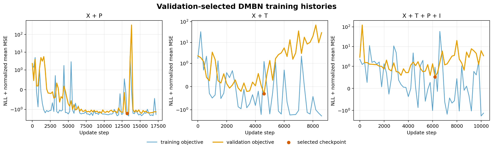
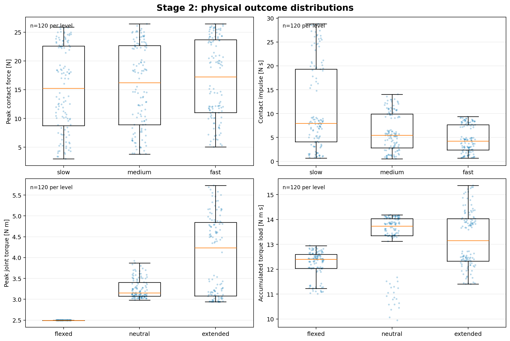
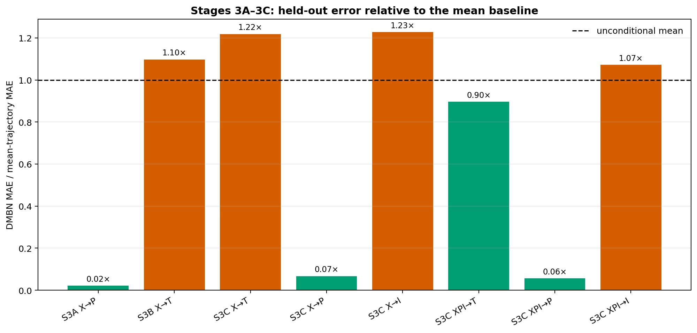
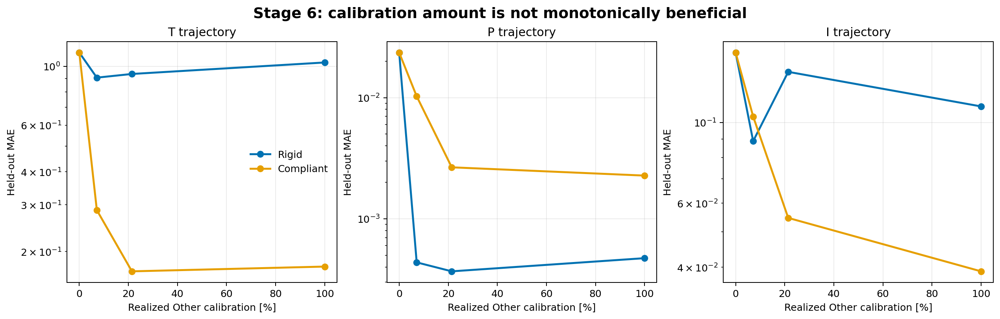
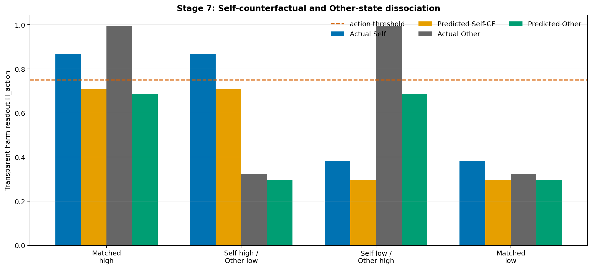
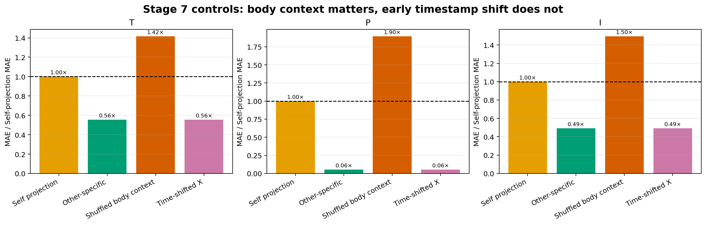
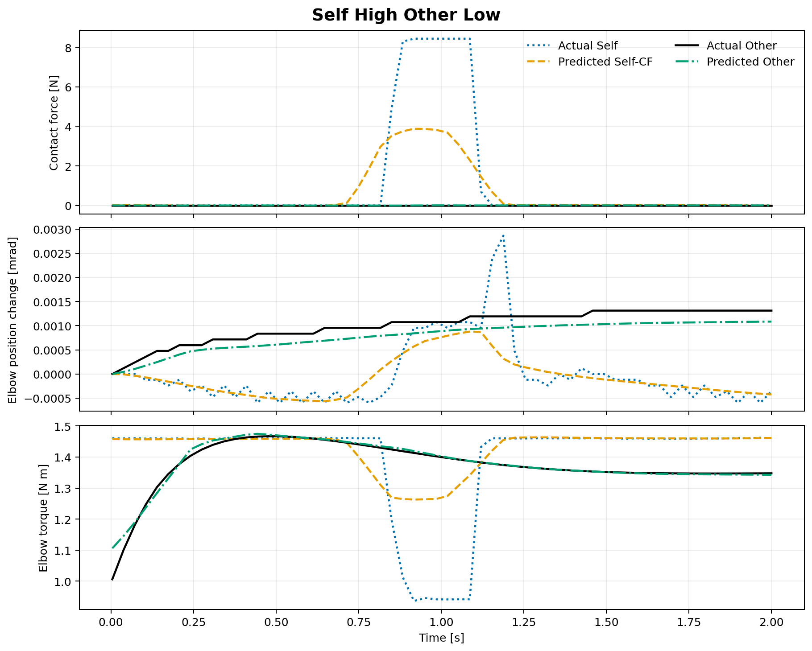
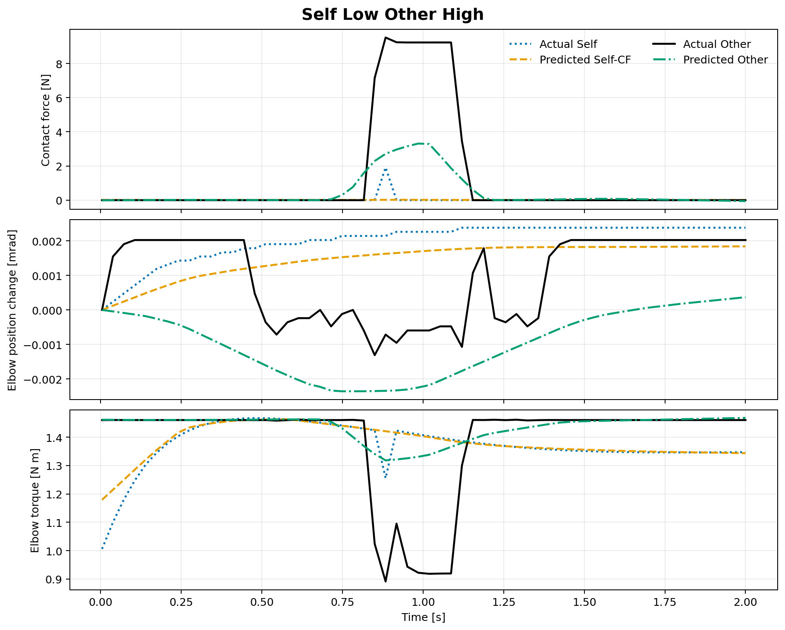
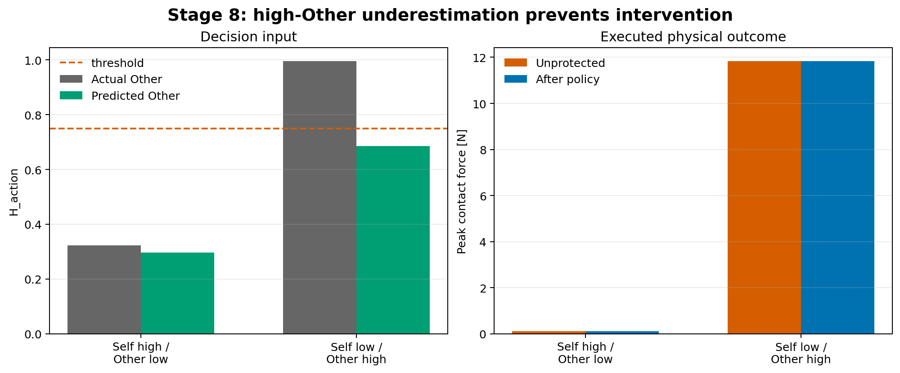

# PyCubSim2 × Deep Modality Blending Networks

## Self経験からSelf反実仮想・Other実状態予測・Self/Other分離・Other保護へ

**本研究の中心的な実行結果は、同一種の外的イベントに対して「Selfならどうなるか」と「Otherに実際に何が起きるか」を連続的な身体状態として分離できた一方、固定閾値によるOther保護行動までは成立しなかった、という部分的成功である。** Other専用モデルはSelf投影に比べ、テスト軌道のMAEを **Tで44.5%・Pで94.5%・Iで50.9%** 改善した。しかし高リスクOtherの予測 `H_action=0.6850` は事前固定閾値 `0.75` を下回り、Stage 8の介入条件を満たさなかった。

- **報告日**: 2026-09-03
- **実行環境**: Python 3.10、NumPy 1.26.4、PyBullet 3.25、SciPy 1.15.2、Matplotlib 3.10.9
- **計算資源**: ローカルCPU、headless PyBullet、GPU不使用
- **ブランチ**: `research/pain-self-other-dmbn`
- **基準コミット**: PyCubSim2 `23353265cba6e32e295fbe98be98f7db8f43152e`
- **結果の範囲**: シミュレータに物理的に接地した身体帰結予測であり、主観的痛み・生物学的共感・意識の実証ではない

---

## 1. 要旨

### 1.1 既知の客観的事実

本研究では、**PyCubSim2/PyBullet** 上で接触、関節運動、関節トルクを発生させ、観測者Aの自己経験と、観測対象Bに生じる身体帰結を別々に収録した。学習対象は **X（視覚）・T（触覚）・P（固有受容）・I（内部機械状態）** の4モダリティであり、研究者が作った隠れた痛みラベル `Y_pain` はDMBNの教師信号にしていない。

物理データはSelfデータセット **363エピソード**、Self/Other解離データセット **160エピソード** である。Selfデータでは、速度から力積への効果量 `η²=0.1820`、姿勢からピークトルクへの効果量 `η²=0.5558`、姿勢から累積負荷への効果量 `η²=0.2024` が得られた。速度からピーク接触力への効果は `η²=0.0091` と小さかった。

学習器は、元論文の **Deep Modality Blending Network（DMBN）** の観測／クエリ形式、モダリティ別エンコーダ、確率的ブレンディング、可用性重み、独立した目標時刻クエリ、モダリティ別確率デコーダを維持した現代化実装である（Seker et al., *Neural Networks*, 2022, [DOI](https://doi.org/10.1016/j.neunet.2021.11.004); [公式実装](https://github.com/myunusseker/Deep-Modality-Blending-Networks)）。

### 1.2 事実に基づく分析

中心的なSelf/Other不一致条件では、モデルが予測した連続値は次のように反転した。

| 条件 | 予測Self-CF `H_action` | 予測Other `H_action` | 実測Other `H_action` | 閾値判定 |
|---|---:|---:|---:|---|
| **Self高 / Other低** | 0.7080 | 0.2961 | 0.3234 | 非介入は正しい |
| **Self低 / Other高** | 0.2963 | 0.6850 | 0.9950 | 非介入は誤り |

したがって、**Self投影とOther状態推定の表現上の分離**は支持された。一方で、予測振幅の過小評価が行動閾値をまたぐため、**選択的Other保護**は支持されなかった。これは実装破損ではなく、連続予測精度と行動判断の間に残った科学的・工学的失敗として保存する。

---

## 2. 研究目的と仮説

### 2.1 研究質問

**主要研究質問**は、ロボットAが自身の物理経験から外的イベントと身体帰結の時間的関係を学び、そのモデルでOther観察からSelf反実仮想を生成し、さらにOther固有情報によってOtherの実状態へ補正できるか、である。

本研究は次の三つを混同しない。

| 概念 | 定義 | 入力 | 正解参照 |
|---|---|---|---|
| **Self actual** | Aが接触を受けたときの実身体状態 | Aへの物理イベント | Aの実測 `T/P/I` |
| **Self counterfactual（Self-CF）** | BへのイベントがAに起きたならどうなるか | Aから見た `X_other` | 同一軌道でAを刺激した対エピソード |
| **Other actual** | Bに実際に生じた身体状態 | `X_other` とB情報 | Bの実測 `T/P/I` |

### 2.2 反証可能な仮説

- **H1**: Self経験で学習したDMBNは、Otherイベント観察からSelf-CF軌道を生成できる。
- **H2**: SelfとOtherの身体条件が異なる場合、Self投影だけではOther実状態を系統的に誤る。
- **H3**: Other固有の較正または身体文脈は、Other実状態予測をSelf投影より改善する。
- **H4**: 改善されたOther予測は、Self高／Other低では介入せず、Self低／Other高では介入する保護行動を支えられる。

### 2.3 研究全体の流れ



**図1**は、Otherを観察した後もSelf-CFとOther予測を別の出力として保持する設計を示す。Other actualセンサは評価時の物理的正解であり、Self-CFの正解と置換しない。

---

## 3. 先行研究との関係

### 3.1 既知の客観的事実

| 世代 | モダリティ | 実証・提案の中心 | 本研究での扱い |
|---|---|---|---|
| **Generation A: Original DMBN** | Vision + Proprioception | 不完全観測、欠損モダリティ補完、任意時刻クエリ、共通潜在表現 | 観測／クエリ意味論と確率的ブレンディングを継承 |
| **Generation B: Artificial Pain** | Vision + Touch | 視覚から将来触覚を回帰し、下流閾値で回避 | DMBNとharm readoutと行動を分離して継承 |
| **Generation C: Silicopathy** | 概念上の多モダリティ | 自己経験を介した他者の内部シミュレーション | 短期の身体経路だけを研究仮説として採用 |
| **Generation D: 本研究** | X + T + P + I | Self実状態、Self-CF、Other実状態、明示的分離、Other保護 | PyBullet実測値で中央仮説を検証 |

- Original DMBN: Seker et al., *Imitation and Mirror Systems in Robots through Deep Modality Blending Networks*, *Neural Networks* 146, 2022（[DOI](https://doi.org/10.1016/j.neunet.2021.11.004)）。
- Artificial Pain: *Artificial Pain Representation with Tactile and Vision Blending*, IEEE-RAS Humanoids 2025（[DOI](https://doi.org/10.1109/Humanoids65713.2025.11203122)）。
- Silicopathy: *Silicopathy: Artificial Empathy through Cognitive and Affective Development of Pain*, IEEE ICDL 2025（[DOI](https://doi.org/10.1109/ICDL63968.2025.11204355)）。
- 物理環境: PyCubSim2公式リポジトリ（[GitHub](https://github.com/yuta4869/PyCubSim2)）。

詳細な引用箇所、実装済み事項、提案に留まる事項、変更理由は [`docs/REFERENCE_AUDIT.md`](../../../docs/REFERENCE_AUDIT.md) に分離している。

### 3.2 事実に基づく分析

Artificial Pain研究の実験的分離である「Vision/Touch学習 → Touch予測 → 下流の痛み判定 → 回避」を維持しつつ、物体カテゴリが害を決める構造は採用しなかった。同じ球形プローブでも、速度、姿勢、接触部位、制御ゲイン、モータ力制限により物理帰結が変化する。このため本研究の予測対象は、物体名に結びついた害ラベルではなく、**外的イベントと身体条件から生じた軌道**である。

---

## 4. 実験装置と物理プロトコル

### 4.1 シミュレーション環境

- **物理ステップ**: 240 Hz
- **左眼RGB**: 約30 Hz、`128 × 128 × 3`
- **1エピソード**: 2.0 s
  - 0.0–0.4 s: ベースライン
  - 0.4–0.9 s: プローブ接近
  - 0.9–1.1 s: 接触
  - 1.1–1.4 s: 除去
  - 1.4–2.0 s: 回復
- **学習用リサンプリング**: 60時点、正規化時刻 `[0,1]`
- **学習用画像**: CPU実験のため決定論的面積平均で `16 × 16 × 3` に縮小
- **プローブ**: 全条件で同じ球形形状を使用し、物体カテゴリを害の手掛かりにしない

### 4.2 モダリティ

| モダリティ | 実測・導出内容 | 学習表現 | 物理単位の保持 |
|---|---|---|---|
| **X: Exteroception** | 左眼RGB、任意ログとしてdepth/segmentation | `[60,16,16,3]`、`[0,1]` | raw RGBを別保存 |
| **T: Touch** | 接触有無、点数、body/link ID、位置、法線力、duration、impulse、相対速度 | 連続・離散接触特徴 | N、N·s、s、m |
| **P: Proprioception** | 左上肢7関節の位置・速度 | `[60,14]` | rad、rad/s相当 |
| **I: Internal mechanical state** | 関節トルク、`abs(torque×velocity)`、累積・低域通過負荷 | `[60,16]` | N·m、N·m/s、N·m·s |

**Iは人間の生物学的インターオセプションではない。** PyBulletの関節状態から直接取得した値、または明記された決定論的変換だけで構成する。

### 4.3 Self factorial実験

**Self Fullデザイン**は `3速度 × 3姿勢 × 2接触部位 × 20反復 = 360接触試行` と、3つの無接触対照からなる。

| 因子 | 水準 | 各組合せの反復 | 操作の目的 |
|---|---|---:|---|
| **速度** | slow / medium / fast | 20 | 力・力積の変化 |
| **姿勢** | flexed / neutral / extended | 20 | 関節トルク・負荷の変化 |
| **接触部位** | hand / forearm | 20 | 局所的T/P/I帰結の変化 |

### 4.4 Self/Other不一致実験

**Dissociationデザイン**は4条件、各20ペア、各ペアをOther actualとSelf参照の2役で実行し、合計 `4 × 20 × 2 = 160エピソード` とした。同じpair seedではプローブ軌道を一致させ、身体条件のみを変えた。

| 条件 | Self身体 | Other身体 | 期待関係 | 主要性 |
|---|---|---|---|---|
| **Matched high** | rigid | rigid | Self高・Other高 | 整合対照 |
| **Self high / Other low** | rigid | compliant | Self高・Other低 | 主要不一致 |
| **Self low / Other high** | compliant | rigid | Self低・Other高 | 主要不一致 |
| **Matched low** | compliant | compliant | Self低・Other低 | 整合対照 |

- **rigid**: `motor_force_scale=1.0`、`position_gain_scale=1.0`
- **compliant**: `motor_force_scale=0.05`、`position_gain_scale=0.10`
- **見かけの統制**:
  - 同一プローブ形状を維持
  - 同一pair seedで外部軌道を対応
  - 色と背景をランダム化
  - A/B役割を実測し、隠れたvulnerability scalarを使わない

---

## 5. データ構造・分割・正規化

### 5.1 Rawエピソード

各エピソードは次を保存する。

- `metadata.json`
  - episode ID、seed、役割、速度、姿勢、対象link、身体条件、制御値、物理／カメラ周波数、ソフトウェア版
- `trajectory.npz`
  - 物理時刻、関節位置・速度・トルク、機械power/load、probe pose、接触点、法線力、link ID、力積
- `rgb.npz`
  - カメラ時刻と左眼RGB

### 5.2 分割

| データセット | 総数 | Train | Validation | Test | 漏洩対策 |
|---|---:|---:|---:|---:|---|
| **Self Full** | 363 | 255 | 54 | 54 | エピソード単位・条件層化 |
| **Dissociation** | 160 | 112 | 24 | 24 | 同一pair seedを同じsplitへ固定 |

**フレーム単位分割は禁止**し、同一エピソードを複数splitにまたがせていない。Dissociationでは同じ外部イベントを共有する対エピソードも同一splitに割り当て、seed漏洩数は **0** である。

### 5.3 正規化

- RGB: `uint8 / 255`
- 時刻: 各2秒区間を `[0,1]` に写像し、物理秒も保持
- T/P/I: training splitの平均・標準偏差だけを使用
- 二値接触: 評価レポートでは二値のまま扱う
- 物理量評価: 逆正規化後にN、N·s、N·m、N·m·sで計算

---

## 6. DMBN実装

### 6.1 保存したアルゴリズム不変条件

**DMBNは自己回帰 `t→t+1` モデルではない。** 各予測は、任意時刻の観測集合と独立したtarget query timeから直接計算する。

1. 各モダリティ `m` の観測を `(t_obs, value_m)` として専用encoderへ入れる。
2. 同一モダリティ内の複数観測表現を平均集約する。
3. 可用性・信頼性 `w_m` と確率係数を用いてモダリティ表現を混合する。
4. 共通潜在表現と独立な `t_query` を各modality decoderへ入れる。
5. 各decoderが平均とscaleを出力する。
6. 複数target timeはベクトル化しても互いの予測値を入力に戻さない。

### 6.2 現代化した実装

| 項目 | 原DMBN notebook | 本実装 | 科学的影響 |
|---|---|---|---|
| **framework** | 旧TensorFlow/Keras | NumPy reverse-mode autodiff | APIだけ変更 |
| **画像encoder** | 6-block CNN | `16×16` RGB用modality-specific MLP | 高解像度表現力は低下 |
| **latent幅** | 共通表現 | 32 | ブレンディング意味論を維持 |
| **非線形** | ReLU系 | Leaky ReLU、slope 0.01 | dead image unitsを回避 |
| **出力** | probabilistic mean/scale | Gaussian mean/softplus scale | 不確実性を保持 |
| **loss** | Gaussian NLL中心 | NLL + normalized mean MSE | mean collapseを抑制 |
| **最適化** | 長時間反復 | validation選択、early stopping、global clip 5.0 | 計算量を現実化 |

元実装との差分と保存した不変条件は [`docs/DMBN_IMPLEMENTATION_NOTES.md`](../../../docs/DMBN_IMPLEMENTATION_NOTES.md) に詳述している。

### 6.3 学習時の観測条件

- **Stage 3A**: X+PでX→P、P→X、過去／未来query、欠損modality、独立queryを検証
- **Stage 3B**: X+TでX→将来T、T→X、部分X→全Tを検証
- **Stage 3C**: X/T/P/IでX-only、XP、XPI、P-only条件を検証
- **Stage 5**: `X_other` をSelf body modelへ与えSelf-CFを生成
- **Stage 6/7**: rigid/compliant別Other modelまたは較正データでOther actualを予測

### 6.4 学習履歴



**図2**の赤点がvalidation objectiveで選択したcheckpointである。X+TとX+T+P+Iではvalidation曲線が後半に悪化し、学習終了時ではなく最良checkpointを使う必要があった。これはtraining objective低下だけでは汎化を保証しないことを示す。

---

## 7. 物理妥当性の結果

### 7.1 分布



**図3**は各因子水準120試行の分布である。速度操作はピーク力よりも接触時間を含む力積に現れ、姿勢操作はピークトルクと累積負荷に現れた。

### 7.2 効果量と自動ゲート

| 関係 | `η²` | 事前ゲート `η²≥0.01` | 判定 | 解釈 |
|---|---:|---:|---|---|
| **速度 → peak force** | 0.0091 | 0.01 | 単独では未達 | 飽和・接触部位差が支配的 |
| **速度 → impulse** | 0.1820 | 0.01 | PASS | 接触持続を含む速度条件差あり |
| **姿勢 → peak torque** | 0.5558 | 0.01 | PASS | 強い姿勢依存 |
| **姿勢 → accumulated load** | 0.2024 | 0.01 | PASS | 中程度の姿勢依存 |

- 接触試行で非ゼロ力: **PASS**
- 無接触対照で約ゼロ力: **PASS**
- 速度関連の物理差: **PASS**
- 姿勢関連の物理差: **PASS**

### 7.3 全18条件の物理平均

| Speed | Posture | Location | n | Peak force [N] | Impulse [N·s] | Peak torque [N·m] | Load [N·m·s] |
|---|---|---|---:|---:|---:|---:|---:|
| fast | extended | forearm | 20 | 24.6219 | 7.9246 | 5.3030 | 13.8297 |
| fast | extended | hand | 20 | 13.2992 | 3.3741 | 3.2212 | 12.4893 |
| fast | flexed | forearm | 20 | 20.0015 | 4.6713 | 2.4948 | 12.3786 |
| fast | flexed | hand | 20 | 7.1224 | 1.0276 | 2.4950 | 12.6774 |
| fast | neutral | forearm | 20 | 24.7147 | 8.4324 | 3.5394 | 14.0674 |
| fast | neutral | hand | 20 | 10.9142 | 2.3382 | 3.2313 | 14.0813 |
| medium | extended | forearm | 20 | 24.0293 | 10.2817 | 4.7893 | 14.0157 |
| medium | extended | hand | 20 | 13.1838 | 4.8437 | 3.1488 | 12.3450 |
| medium | flexed | forearm | 20 | 18.7237 | 5.9384 | 2.4948 | 12.0219 |
| medium | flexed | hand | 20 | 5.2584 | 1.0841 | 2.4949 | 12.6236 |
| medium | neutral | forearm | 20 | 23.4935 | 11.8199 | 3.2920 | 13.4982 |
| medium | neutral | hand | 20 | 8.7998 | 2.7804 | 3.1003 | 13.8440 |
| slow | extended | forearm | 20 | 24.0886 | 18.6638 | 4.6261 | 14.8372 |
| slow | extended | hand | 20 | 12.3173 | 7.2302 | 3.0375 | 11.7591 |
| slow | flexed | forearm | 20 | 17.9574 | 8.4896 | 2.4945 | 11.2096 |
| slow | flexed | hand | 20 | 4.6692 | 1.2894 | 2.4949 | 12.4764 |
| slow | neutral | forearm | 20 | 23.3339 | 26.0159 | 3.2907 | 10.9019 |
| slow | neutral | hand | 20 | 8.6706 | 4.0990 | 3.0736 | 13.3595 |

### 7.4 事実に基づく分析

速度の単純な順位とピーク力は一致していない。低速条件ほど接触が長くなり、力積が大きくなる組合せもある。この結果は「速いほど常に危険」という単純ラベルを否定し、身体姿勢・接触部位・持続時間を含む多変量軌道を予測する必要性を示す。ただし、この設計だけから各操作の因果効果を厳密に同定したとは主張しない。

---

## 8. Self DMBNの結果

### 8.1 軌道MAEとベースライン

| Stage / Context | Target | DMBN MAE | Unconditional mean MAE | 相対結果 |
|---|---|---:|---:|---:|
| **3A X→P** | P | 0.000815 | 0.038775 | 97.9%低い |
| **3A P→X** | X | 0.005895 | 0.043111 | 86.3%低い |
| **3B X→T** | T | 2.944523 | 2.683248 | 9.7%高い |
| **3B T→T** | T | 2.282981 | 2.683248 | 14.9%低い |
| **3C X→P** | P | 0.002578 | 0.038775 | 93.4%低い |
| **3C X→T** | T | 3.269444 | 2.683248 | 21.8%高い |
| **3C X→I** | I | 0.219652 | 0.178898 | 22.8%高い |
| **3C X+P+I→T** | T | 2.404786 | 2.683248 | 10.4%低い |
| **3C X+P+I→I** | I | 0.191741 | 0.178898 | 7.2%高い |



**図4**では1.0未満がmean trajectoryより良い。Pは大幅に改善する一方、X-onlyのT/I振幅はmeanを下回らない。Xに早期P/Iを追加した場合だけTがmeanを **10.4%** 上回った。

### 8.2 時間構造

- Stage 3B X→Tのcontact onset error: **−0.0194 s**
- mean trajectoryのcontact onset error: **0.1384 s**
- Stage 3B X→Tの平均peak force過小評価: **5.55 N**

### 8.3 事実に基づく分析

- **Q1の答え**: Self X/T/P/I学習は部分的に支持された。X/Pは強いが、T/Iの絶対振幅は不十分である。
- **Q2の答え**: early XはPと接触時刻を予測できたが、将来T/I振幅の十分条件ではなかった。
- Stage 3Bは接触の「いつ」をmeanより捉えたが、「どれほど強いか」を過小評価した。したがってStage 3Bを成功とだけ表現するのは不正確で、**PARTIAL**が妥当である。

---

## 9. Harm readoutとSelf保護

### 9.1 透明な下流readout

**DMBNの主出力はT/P/Iであり、`H_action` は行動判断専用の後処理である。** training splitの95パーセンタイルを基準に各比を `[0,2]` へclipし、次式を使った。

```text
H_action = 0.35 × peak_force / F95
         + 0.25 × impulse / J95
         + 0.20 × peak_torque / τ95
         + 0.20 × accumulated_load / L95
```

- **行動閾値**: `H_action ≥ 0.75`
- **高予測時**: arm withdrawalまたはprobe stop
- **低予測時**: 継続

この重みは透明な工学的意思決定基準であり、主観的痛みの尺度ではない。閾値はStage 8の結果を見てから変更していない。

---

## 10. Other予測と較正

### 10.1 較正量ごとの結果

| B condition | Requested / Realized | T MAE | P MAE | I MAE |
|---|---:|---:|---:|---:|
| **Rigid** | 5% / 7.14% | 0.906795 | 0.000437 | 0.088874 |
| **Rigid** | 20% / 21.43% | 0.936255 | 0.000368 | 0.137808 |
| **Rigid** | 100% / 100% | 1.034545 | 0.000473 | 0.110722 |
| **Compliant** | 5% / 7.14% | 0.286459 | 0.010254 | 0.103849 |
| **Compliant** | 20% / 21.43% | 0.168263 | 0.002660 | 0.054644 |
| **Compliant** | 100% / 100% | 0.175357 | 0.002273 | 0.038963 |



**図5**が示すとおり、較正量と精度は単調関係ではない。RigidのTは7.14%較正が最小MAE、Pは21.43%、Iは7.14%であり、単純に100%へ増やせば全指標が改善するわけではなかった。

### 10.2 事実に基づく分析

- **Q4の答え**: Self-only transferは弱い。Self投影はOther専用予測よりT/P/Iすべてで大きな誤差を示した。
- **Q5の答え**: Other身体文脈はSelf投影より有効だが、較正データ量の増加が単調に有効という仮説は支持されない。
- 実現率7.14%と21.43%は、condition-stratifiedな整数エピソード選択によりrequested 5%/20%からずれた値である。
- condition-wise meanが一部のrigid/I比較でDMBNより強く、モデル複雑性自体が改善の理由とはいえない。

---

## 11. 中心実験: Self/Other解離

### 11.1 Harm readoutの4条件



| Condition | Actual Self H | Predicted Self-CF H | Actual Other H | Predicted Other H | Predicted action |
|---|---:|---:|---:|---:|---|
| **Matched high** | 0.8682 | 0.7081 | 0.9950 | 0.6850 | 非介入 |
| **Self high / Other low** | 0.8682 | 0.7080 | 0.3234 | 0.2961 | 非介入 |
| **Self low / Other high** | 0.3838 | 0.2963 | 0.9950 | 0.6850 | 非介入 |
| **Matched low** | 0.3838 | 0.2963 | 0.3234 | 0.2961 | 非介入 |

**図6**では、Self-CFはSelf身体条件に追従し、Other予測はOther身体条件に追従している。特に主要2条件で予測の大小関係が反転したため、連続表現上は単純Self投影から分離できている。ただし高状態を一貫して過小評価し、0.75の行動閾値を越えない。

### 11.2 Self投影に対する改善

| Target | Self-projection MAE | Other-specific MAE | 改善率 | Shuffled-context MAE |
|---|---:|---:|---:|---:|
| **T** | 1.089944 | 0.604951 | 44.5% | 1.543973 |
| **P** | 0.024899 | 0.001373 | 94.5% | 0.047189 |
| **I** | 0.152389 | 0.074842 | 50.9% | 0.227863 |

### 11.3 Shortcut control



| Control | T / Self projection | P / Self projection | I / Self projection | 期待と結果 |
|---|---:|---:|---:|---|
| **Self projection** | 1.00× | 1.00× | 1.00× | 比較基準 |
| **Other-specific** | 0.56× | 0.06× | 0.49× | 改善、身体固有予測を支持 |
| **Shuffled body context** | 1.42× | 1.90× | 1.50× | 悪化、文脈利用を支持 |
| **Time-shifted X** | 0.56× | 0.06× | 0.49× | ほぼ不変、時間利用を支持せず |

**図7**は、身体文脈を誤対応させると全モダリティで悪化する一方、early Xの時刻を0.25ずらしても誤差が変わらないことを示す。したがって「body contextが必要」は支持されるが、「early Xの正しい観測時刻がこの結果を生んだ」は支持されない。

### 11.4 Self高 / Other低の代表軌道



**図8**では、Actual Selfに大きい接触力があり、Actual Otherにはほぼ接触力がない。Predicted Self-CFは高い力を予測し、Predicted Otherは低く抑える。Pは初期値からの肘位置変化をmradで表示し、Iは肘トルクを物理単位で示す。

### 11.5 Self低 / Other高の代表軌道



**図9**ではActual Otherに約9 Nの接触力が生じる一方、Actual Selfは低い。Predicted Otherは方向を正しく高くするが、ピークを約3 Nに過小評価する。Self-CFはほぼゼロ接触を予測し、SelfとOtherの分離方向は正しい。

### 11.6 事実に基づく分析

- **Q3の答え**: Other観察からSelf-CF出力を生成し、対となるA実測軌道に対して評価できた。ただしhigh amplitudeは過小評価した。
- **Q6の答え**: Self高／Other低とSelf低／Other高を連続値では区別できた。
- H2は支持された。Self projectionは主要不一致条件でOther専用予測より大きな軌道誤差を示した。
- H3は部分的に支持された。正しいbody contextは改善し、shufflingで悪化したが、較正量に単調な効果はなかった。
- time-shift controlの失敗から、観測／クエリ意味論が実装されていることと、実データで観測時刻が有効利用されたことは別である。

---

## 12. Other保護の結果

### 12.1 実行結果



| 条件 | Actual Other H | Predicted Other H | Expected action | Executed action | 物理結果 |
|---|---:|---:|---|---|---|
| **Self high / Other low** | 0.3234 | 0.2961 | 非介入 | 非介入 | 正しい |
| **Self low / Other high** | 0.9950 | 0.6850 | 介入 | 非介入 | 誤り、force低減なし |

**図10**の左はdecision input、右は政策実行後のpeak forceである。高リスクOther予測が閾値未満だったためstop-probeが発火せず、保護前後のピーク力は変化しなかった。

### 12.2 事実に基づく分析

- **Q7の答え**: 事前固定閾値0.75での選択的Other保護は支持されない。
- H4は棄却された。連続値の大小関係が正しくても、calibration不足で意思決定閾値を越えなければ行動は失敗する。
- 結果を見て閾値を0.685未満へ変更すれば成功扱いにできるが、それはpost-hocな成功の作成になるため実施していない。

---

## 13. 実装失敗と科学的負の結果

### 13.1 修正済みの実装失敗

| 問題 | 根本原因 | 修正 | 再検証 |
|---|---|---|---|
| **PyBullet cylinder作成失敗** | visual shapeは`length`、collision shapeは`height`を要求 | API引数を用途別に修正 | headless試行PASS |
| **X encoder勾配消失** | 正値中心RGBとplain ReLUで64 image hidden unitsがdead | Leaky ReLU 0.01 | X→Pがmeanを改善 |
| **予測mean collapse** | NLLだけでscale増大が難しいT/Iを吸収 | NLL + normalized mean MSE、clip 5.0 | mean predictionを再評価 |
| **split leakage risk** | 同一seedのSelf/Other対が別splitに入り得た | seed-grouped split | 回帰テスト、leakage=0 |

### 13.2 保存した科学的負の結果

- **X-onlyのT/I振幅予測はunconditional meanを上回らない。**
- **Stage 3B X→Tのtrajectory MAEはmeanより9.7%悪い。**
- **Other較正量を増やしても精度は単調改善しない。**
- **0.25 normalized-time shiftで誤差が悪化しない。**
- **high Otherを過小評価し、Stage 8の介入に失敗した。**

これらはshape error、NaN、gradient disconnect、timestamp破損、接触欠如、split漏洩ではないことを確認した後の結果であり、都合のよい再調整で除去していない。

---

## 14. 研究質問への回答

| Research question | 結論 | 定量的根拠 | Status |
|---|---|---|---|
| **Q1: Self X/T/P/Iを学習できるか** | 部分的 | X→P 97.9%改善、XPI→T 10.4%改善、Iはmean未達 | PARTIAL |
| **Q2: early Xから将来Self帰結を予測できるか** | Pと接触時刻のみ支持 | onset −0.0194 s、T/I振幅はmean未達 | PARTIAL |
| **Q3: Other観察からSelf-CFを生成できるか** | 支持 | 別出力と対A実測参照を保存 | DONE |
| **Q4: Self-onlyがOther actualへ転移するか** | 弱い | Other-specificがT/P/Iで44.5/94.5/50.9%改善 | NEGATIVE |
| **Q5: Other較正・文脈が改善するか** | 文脈は支持、量の単調性は不支持 | shuffleで1.42/1.90/1.50×へ悪化 | PARTIAL |
| **Q6: 二つの不一致条件を分けられるか** | 連続値で支持 | Other H 0.2961 vs 0.6850 | DONE |
| **Q7: 選択的Other保護を行えるか** | 不支持 | 0.6850 < 0.75、介入なし | PARTIAL/FAILED GATE |

---

## 15. Stage status

**DONEはコード、テスト、smoke/full実行、必要出力、acceptance checkが揃った場合だけに付与した。**

| Stage | Status | 実行済み根拠 |
|---|---|---|
| **0** | DONE | 3論文・公式notebookを監査し、audit/spec/notesを作成 |
| **1** | DONE | deterministic X/T/P/I、無接触、接触、同期、2体試験 |
| **2** | DONE | 360接触+3対照、全physics gate PASS |
| **3A** | DONE | DMBN semantics試験、X→P/P→Xがmeanを改善 |
| **3B** | PARTIAL | X↔T実行済み、onset改善、X→T MAEはmean未達 |
| **3C** | PARTIAL | X/XP/XPI/P条件実行、XPI→Tのみ主要改善 |
| **4** | PARTIAL | readoutとstop機構実装、high予測が閾値未達 |
| **5** | DONE | A視点のOther観察、Self-CF、対Self参照を保存 |
| **6** | DONE | Other actual、0/5/20/100%較正を評価 |
| **7** | DONE | 4条件、別出力、shuffle/time-shift対照を評価 |
| **8** | PARTIAL | 政策実行済み、Self-low/Other-high介入gateは失敗 |

---

## 16. テストと検証

### 16.1 実行済みテスト

| Test group | 結果 | 時間 | 対象 |
|---|---:|---:|---|
| **Research tests** | 16/16 PASS | 20.124 s | simulation、dataset、DMBN、split、protection |
| **Upstream non-GUI tests** | 10/10 PASS | 5.286 s | scene、camera、sensor、IK、controller、multi-robot |
| **GUI test** | 実行環境でABORT | — | macOS sandboxのTk/AppKit制約 |

GUI testの`NSInternalInconsistencyException`はpassとして数えていない。headless cameraとsimulationは別テストで通過している。

### 16.2 DMBN semantics test

- 任意観測時刻
- 過去query、未来query
- X-only→P、P-only→X
- modality availability zero
- 複数query timeの独立予測
- set order invariance
- 4モダリティshape
- 予測値を次時刻入力へ戻さない非自己回帰性

---

## 17. 成果物

### 17.1 データセット

| Dataset | Path | Episodes | Split | Size |
|---|---|---:|---|---:|
| **Self Mini raw** | `data/raw/self_mini` | 57 | source | 8.8 MB |
| **Self Mini processed** | `data/processed/self_mini` | 57 | 21/18/18 | 0.9 MB |
| **Self Full raw** | `data/raw/self_full` | 363 | source | 56.8 MB |
| **Self Full processed** | `data/processed/self_full` | 363 | 255/54/54 | 5.8 MB |
| **Dissociation raw** | `data/raw/dissociation` | 160 | source | 31 MB |
| **Dissociation processed** | `data/processed/dissociation` | 160 | 112/24/24 | 3.2 MB |

表中のpathは `experiments/pain_self_other/` からの相対pathである。生成データ、checkpoint、prediction arraysはローカルに保存され、Git管理対象外である。

### 17.2 主要checkpoint

| Experiment ID | Checkpoint | Train / Validation | 代表結果 |
|---|---|---:|---|
| **S3A_DMBN_XP_full** | `checkpoints/S3A_DMBN_XP_full/best_model.npz` | 255/54 | X→P 0.000815 |
| **S3B_DMBN_XT_full** | `checkpoints/S3B_DMBN_XT_full/best_model.npz` | 255/54 | X→T 2.944523 |
| **S3C_DMBN_XTPI_full** | `checkpoints/S3C_DMBN_XTPI_full/best_model.npz` | 255/54 | XPI→T 2.404786 |
| **S5_SELF_CF_rigid/compliant** | `checkpoints/S5_SELF_CF_*` | 各28/6 | 別Self body予測 |
| **S6_OTHER_*_005** | `checkpoints/S6_OTHER_*_005` | 各2/6 | realized 7.14% |
| **S6_OTHER_*_020** | `checkpoints/S6_OTHER_*_020` | 各6/6 | realized 21.43% |
| **S6_OTHER_*_100** | `checkpoints/S6_OTHER_*_100` | 各28/6 | Other専用model |

### 17.3 図

| No. | File | 内容 | 元データ |
|---:|---|---|---|
| **1** | `figures/01_study_design.png` | 研究設計 | 実装仕様 |
| **2** | `figures/02_physics_distributions.png` | 物理分布 | raw Self metadata |
| **3** | `figures/03_training_history.png` | 学習履歴 | checkpoint history JSON |
| **4** | `figures/04_self_model_vs_baseline.png` | Self model相対MAE | Stage 3 metrics JSON |
| **5** | `figures/05_other_calibration.png` | 較正率とMAE | Stage 6 metrics JSON |
| **6** | `figures/06_dissociation_harm.png` | 4条件H | Stage 7 metrics JSON |
| **7** | `figures/07_dissociation_controls.png` | shortcut control | Stage 7 metrics JSON |
| **8** | `figures/08_self_high_other_low_trajectory.png` | 不一致条件2の軌道 | Stage 7 prediction NPZ |
| **9** | `figures/09_self_low_other_high_trajectory.png` | 不一致条件3の軌道 | Stage 7 prediction NPZ |
| **10** | `figures/10_protection_result.png` | 保護判定と物理結果 | Stage 7/8 metrics JSON |

図は [`report_figures.py`](../report_figures.py) で保存済みmetrics/raw metadata/prediction arraysから再生成できる。

### 17.4 シミュレーション動画

**動画はレンダリング用に作り直した架空映像ではなく、各実験で保存したPyCub左眼RGBと240 Hz物理ログを時刻同期して再生したものである。** 原画像は128×128、30 Hz、2秒間であり、視認性のため最近傍拡大し、各frameを2回表示して0.5倍速の4秒動画にした。

| No. | 動画 | 内容 | 解像度 / 長さ |
|---:|---|---|---|
| **1** | [01_self_physics_speed.mp4](videos/01_self_physics_speed.mp4) | slow/medium/fastのSelf接触を同時比較 | 1280×720 / 4.0 s |
| **2** | [02_other_observation_four_conditions.mp4](videos/02_other_observation_four_conditions.mp4) | 4つのSelf/Other条件をAの視点で比較 | 1280×720 / 4.0 s |
| **3** | [03_self_other_mismatch_pairs.mp4](videos/03_self_other_mismatch_pairs.mp4) | 主要不一致2条件のSelf参照とOther actual | 1280×720 / 4.0 s |
| **4** | [04_protection_decision_replay.mp4](videos/04_protection_decision_replay.mp4) | predicted Other H、閾値、Stage 8判断失敗 | 1280×720 / 4.0 s |

全動画にはsimulation time、phase、身体条件、接触力、力積、ピークトルク、累積負荷、接触力履歴を同期表示した。動画3は同じevent seedに対するSelfとOtherの物理差を直接示す。動画4は高Otherでも `0.6850 < 0.7500` となり、`NO INTERVENTION` が選ばれた負の結果を保存している。使用エピソードとframe数は [`videos/manifest.json`](videos/manifest.json) に記録した。

---

## 18. 再現手順

### 18.1 環境とテスト

```bash
export MPLCONFIGDIR=/tmp/dmbnv3-mpl
PY=/opt/miniconda3/envs/pycub310/bin/python

$PY -m unittest -v tests.test_pain_self_other
$PY -m unittest -v tests.test_pycubsim2.ConfigTests tests.test_pycubsim2.SimulationTests
```

### 18.2 Selfデータ生成・前処理・物理評価

```bash
$PY -m experiments.pain_self_other.run generate \
  --design self --repetitions 20 \
  --output experiments/pain_self_other/data/raw/self_full \
  --seed 20261000

$PY -m experiments.pain_self_other.run prepare \
  --raw experiments/pain_self_other/data/raw/self_full \
  --processed experiments/pain_self_other/data/processed/self_full \
  --manifest experiments/pain_self_other/data/manifests/self_full.csv \
  --normalization experiments/pain_self_other/data/manifests/self_full_normalization.json \
  --seed 20261000

$PY -m experiments.pain_self_other.run physics-report \
  --raw experiments/pain_self_other/data/raw/self_full \
  --output experiments/pain_self_other/reports/STAGE2_PHYSICS_VALIDATION_FULL.md
```

### 18.3 Stage 3A–3C学習

```bash
$PY -m experiments.pain_self_other.run train \
  --manifest experiments/pain_self_other/data/manifests/self_full.csv \
  --normalization experiments/pain_self_other/data/manifests/self_full_normalization.json \
  --modalities XP --role self \
  --output experiments/pain_self_other/checkpoints/S3A_DMBN_XP_full \
  --steps 20000 --validate-every 200 --patience 20 --seed 20260903

$PY -m experiments.pain_self_other.run train \
  --manifest experiments/pain_self_other/data/manifests/self_full.csv \
  --normalization experiments/pain_self_other/data/manifests/self_full_normalization.json \
  --modalities XT --role self \
  --output experiments/pain_self_other/checkpoints/S3B_DMBN_XT_full \
  --steps 30000 --validate-every 200 --patience 20 --seed 20260904

$PY -m experiments.pain_self_other.run train \
  --manifest experiments/pain_self_other/data/manifests/self_full.csv \
  --normalization experiments/pain_self_other/data/manifests/self_full_normalization.json \
  --modalities XTPI --role self \
  --output experiments/pain_self_other/checkpoints/S3C_DMBN_XTPI_full \
  --steps 40000 --validate-every 200 --patience 20 --seed 20260905
```

### 18.4 Dissociationデータと中心評価

```bash
$PY -m experiments.pain_self_other.run generate \
  --design dissociation --repetitions 20 \
  --output experiments/pain_self_other/data/raw/dissociation \
  --seed 20262000 --no-controls

$PY -m experiments.pain_self_other.run prepare \
  --raw experiments/pain_self_other/data/raw/dissociation \
  --processed experiments/pain_self_other/data/processed/dissociation \
  --manifest experiments/pain_self_other/data/manifests/dissociation.csv \
  --normalization experiments/pain_self_other/data/manifests/dissociation_normalization.json \
  --seed 20262000

$PY -m experiments.pain_self_other.run dissociation-report \
  --manifest experiments/pain_self_other/data/manifests/dissociation.csv \
  --normalization experiments/pain_self_other/data/manifests/dissociation_normalization.json \
  --self-rigid-model experiments/pain_self_other/checkpoints/S5_SELF_CF_rigid/best_model.npz \
  --self-compliant-model experiments/pain_self_other/checkpoints/S5_SELF_CF_compliant/best_model.npz \
  --other-rigid-model experiments/pain_self_other/checkpoints/S6_OTHER_rigid_100/best_model.npz \
  --other-compliant-model experiments/pain_self_other/checkpoints/S6_OTHER_compliant_100/best_model.npz \
  --output experiments/pain_self_other/outputs/S7_DISSOCIATION_full
```

body/fraction別の全学習コマンドとStage 8コマンドは [`docs/PAIN_SELF_OTHER_HANDOFF.md`](../../../docs/PAIN_SELF_OTHER_HANDOFF.md) を正本とする。

### 18.5 本報告書の図を再生成

```bash
$PY -m experiments.pain_self_other.report_figures
```

スクリプトは10個のPNGが存在することを`assert`し、欠損時に非ゼロ終了する。

### 18.6 シミュレーション動画を再生成

```bash
$PY -m experiments.pain_self_other.render_videos
```

動画生成は既存のOpenCV `mp4v` encoderを使用し、新しい依存を追加しない。各MP4を再度開いてframe数と先頭frameを検査し、不完全な動画では非ゼロ終了する。

---

## 19. 限界と主張可能範囲

### 19.1 限界

- **画像表現力**: 原DMBNのCNNではなく`16×16` MLPであり、触覚・内部状態の振幅推定が弱い。
- **時間利用**: 観測／query APIは正しいが、time-shift controlが効かず、実データでは画像内容に強く依存した可能性がある。
- **Other文脈**: rigid/compliant別model選択は明示的なbody contextであり、未観測の身体特性を視覚だけから推定した結果ではない。
- **標本数**: Dissociation testは24エピソードで、各条件のtest seed数は小さい。
- **環境範囲**: deterministic simulation、単一プローブ、単一上肢、2秒軌道に限定される。
- **行動校正**: continuous orderingは正しいがhigh amplitudeが低く、固定閾値のrobust calibrationが不足する。

### 19.2 現時点で主張できること

- PyBullet実測X/T/P/Iを用いた**multimodal bodily-consequence prediction**
- Other観察からの**Self-based counterfactual simulation**
- 身体条件が異なる場合の**Self/Other continuous-state dissociation**
- body contextに依存した**Other-state prediction**
- subjective empathyではなく**empathy-like computational precursor**としての限定的結果

### 19.3 主張できないこと

- ロボットが主観的に痛みを感じたこと
- 生物学的なmirror neuronまたは共感の実証
- 人間のinteroception
- consciousness、moral agency、altruism
- 現実ロボットや人間への一般化

---

## 20. 結論と次の技術的優先事項

**中心科学命題のうち、「Self-CFとOther actualを分ける」部分は連続軌道とharm readoutの双方で支持された。** Self投影よりOther専用予測が良く、body contextをshuffleすると悪化したため、Other身体情報が予測に寄与した。ただし、X-onlyのT/I振幅、較正量の単調効果、画像時刻への依存、固定閾値でのOther保護は支持されなかった。

**最優先の次工程は、Stage 7のtest splitと閾値を固定したまま、training/validationだけで高力状態のT/I振幅calibrationを改善することである。** 具体的には、原DMBNに近い画像CNNへ置換し、validation上のpeak-force/impulse calibration lossを追加したうえで、既存のSelf低／Other高testを一度だけ再評価する。この手順なら、負の結果を消すpost-hoc閾値変更を避けながら、Stage 8失敗の直接原因を検証できる。
